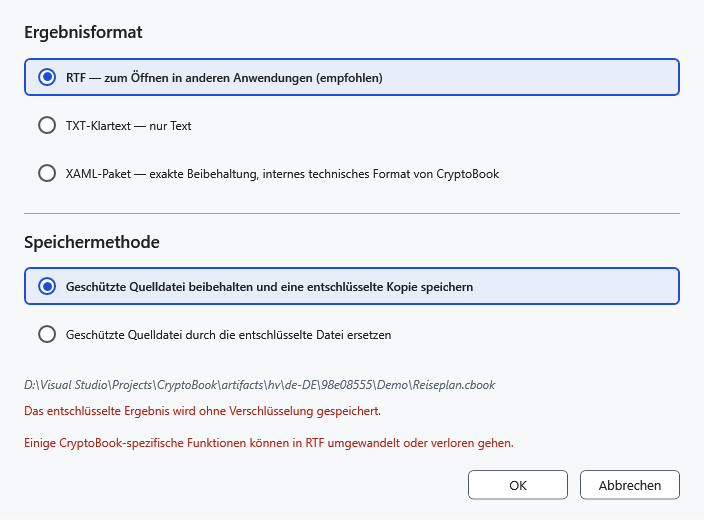
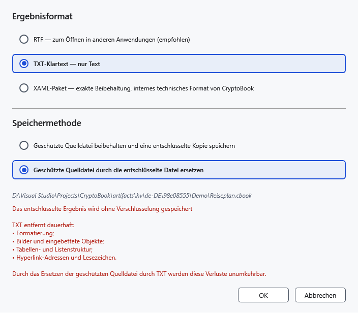

# Dateien und Ordner entschlüsseln

Das entschlüsselte Ergebnis ist ohne Schlüssel lesbar. Prüfen Sie vor dem Ersetzen einer geschützten Quelle, ob Sie offene Daten hinterlassen möchten und das richtige Format gewählt haben.

## Vorgehen

1. Markieren Sie die geschützte Datei im Dateimanager und wählen Sie **Ausgewählte Elemente entschlüsseln**. Sie benötigen den ursprünglichen Schlüssel.
2. Wählen Sie für eine einzelne .cbook/.cbox das Ausgabeformat. **RTF — zum Öffnen in anderen Anwendungen (empfohlen)** eignet sich für andere Editoren. TXT behält nur Text und verliert Bilder, Tabellen und Formatierung. Das Originalformat bewahrt den ursprünglichen Inhalt. Die Auswahl richtet sich nach dem Inhalt, nicht nur dem Containernamen.
3. Wählen Sie **Geschützte Quelldatei beibehalten und eine entschlüsselte Kopie speichern** oder **Geschützte Quelldatei durch die entschlüsselte Datei ersetzen**. Eine Kopie benötigt einen Zielort; Ersetzen entfernt die geschützte Quelle erst nach erfolgreichem Speichern der Ausgabe und verlangt eine gesonderte Bestätigung.

Beim Ersetzen mit TXT wird zusätzlich vor Formatverlust gewarnt. Stimmen Sie nicht zu, wenn Bilder oder Tabellen benötigt werden. Bewahren Sie ein geschütztes Original für die Rückkehr auf.

## Ordner, Stapel und Ergebnis

Ordner und mehrere Elemente haben eine eigene Auswahl für Kopie oder Ersetzen. Ordner werden rekursiv verarbeitet; ungeschützte Dateien werden beim Entschlüsseln übersprungen. Kopien erhalten vorhandene Ziele und bekommen bei Konflikten eindeutige Namen. Öffnen Sie das Ergebnis im passenden Editor und prüfen Sie Text und Formatierung.

Eine lesbare Android-Datei kann entschlüsselt werden. Ersetzen erfordert zusätzlich Schreib- und Löschrechte. Daraus folgt keine Unterstützung für die Verschlüsselung eines ganzen entfernten Ordners.

## Abbruch und Fehler

**Abbrechen** in den Optionen bricht die Entschlüsselung vor dem Schreiben ab. Nach Abbruch im Fortschrittsfenster warten Sie auf das Ende; fertige Ergebnisse können bleiben. Geben Sie bei falschem Schlüssel das ursprüngliche Kennwort ein. Prüfen Sie bei Schreibfehlern Zugriff und freien Platz und behalten Sie den Container bis zur Prüfung des Ergebnisses.

- [Schutz](help:security.protect)
- [Gerätegrenzen](help:devices.limits)
- [Formate](help:doc.formats)
