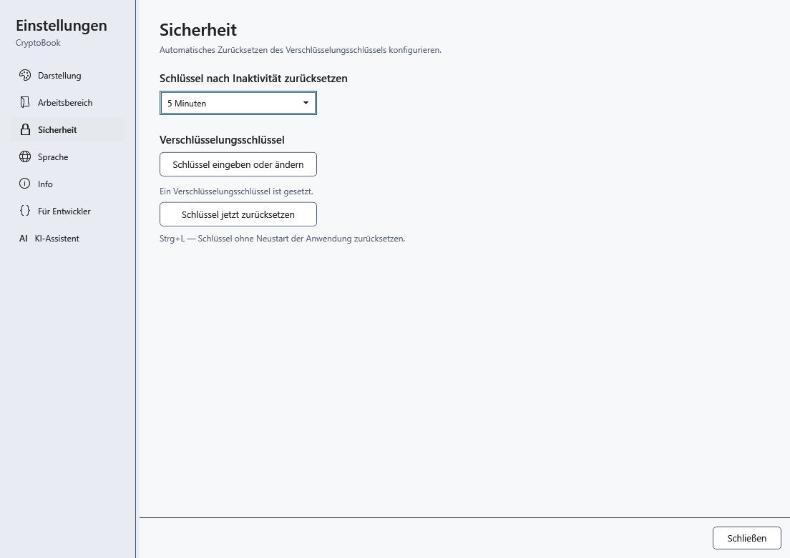
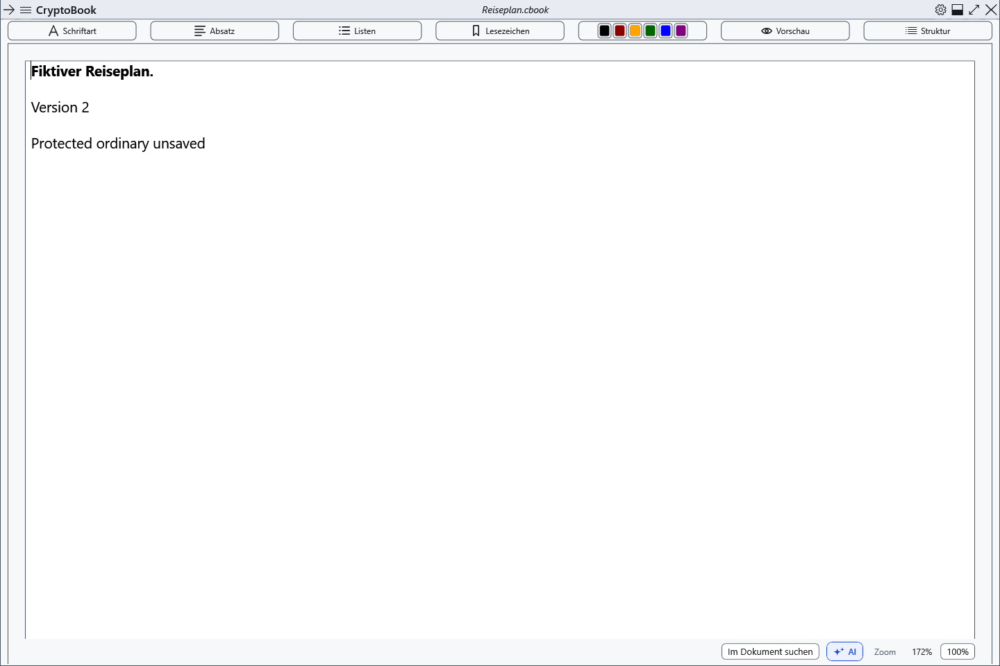

# Schlüssel zurücksetzen und Arbeit sperren

Strg+L entfernt den Schlüssel aus dem Anwendungsspeicher. Sind nur gewöhnliche Dokumente geöffnet, bleiben sie mit ungespeicherten Änderungen offen. Ein vorhandener Schlüssel macht sie nicht automatisch geschützt.

## Einstellung und manuelles Zurücksetzen

1. Öffnen Sie die Einstellungen → **Sicherheit**.
2. Wählen Sie bei **Schlüssel nach Inaktivität zurücksetzen** 1, 5, 10, 15 oder 30 Minuten oder **Nie**. Die Änderung gilt sofort; Standard sind 15 Minuten. Aktivität in CryptoBook startet den Countdown neu, längere Dateioperationen halten ihn an.
3. Drücken Sie Strg+L im Hauptfenster/in den Einstellungen oder wählen Sie **Schlüssel jetzt zurücksetzen**. Ohne Schlüssel gibt es nichts zurückzusetzen. Fokusverlust allein setzt ihn nicht zurück; die Windows-Sitzungssperre und der Ruhemodus lösen ein sicheres Zurücksetzen aus.

## Geschützter Arbeitsbereich

CryptoBook speichert und prüft eine geschützte Momentaufnahme und leert danach Schlüssel und geschützte Editoren. Sind beide unabhängigen Dokumente geschützt, enthält sie beide. Ist nur eines geschützt, bleibt sein gewöhnlicher Nachbar getrennt im Arbeitsbereich erhalten. Inhaltsfenster werden verborgen/geschlossen und AI-Aktivität endet.

Nach Erfolg bleibt gewöhnliche Arbeit möglich. Die Wiederherstellung einer Momentaufnahme ist auf Ihren Befehl im Seitenmenü verfügbar. Scheitert das Erstellen der Kopie, wird der Schlüssel trotzdem entfernt und ungespeicherte geschützte Arbeit bleibt hinter einem Sperrbildschirm im Speicher verborgen. **Lassen Sie die Anwendung geöffnet:** Entsperren Sie mit dem bisherigen Kennwort und speichern Sie.

## Zurückkehren

Öffnen Sie das Seitenmenü → **Datei** → **Momentaufnahme nach Schlüsselreset wiederherstellen**. Für Arbeit, die nach einem Fehler beim Erstellen der Momentaufnahme im Speicher verborgen bleibt, verwenden Sie **Entsperren**. Ein Eingabeabbruch erhält die Kopie. **Nie** deaktiviert den Inaktivitätstimer; manuelles Zurücksetzen und Systemereignisse bleiben wirksam.

- [Wiederherstellung einer Sperrkopie](help:recovery.lock)
- [Schlüsseleingabe](help:security.password)
- [AI-Lebenszyklus](help:ai.lifecycle)
