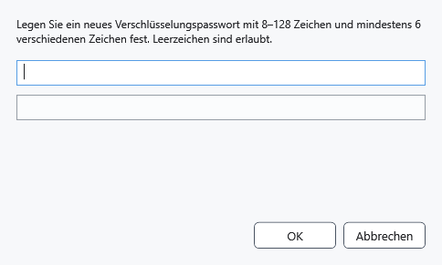
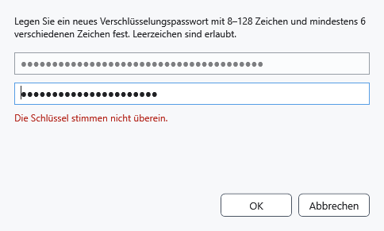

# Schlüssel und Kennwort

Der Schlüssel öffnet geschützte Dateien. Ein anderer eingegebener Schlüssel ändert das Kennwort bereits gespeicherter Dateien nicht. Bewahren Sie Ihr Kennwort sicher auf: CryptoBook kann es nicht mithilfe des Windows-Kennworts zurücksetzen.

## Vorgehen

1. Öffnen Sie die Einstellungen → **Sicherheit** → **Schlüssel eingeben oder ändern**, oder **Verschlüsselungsschlüssel festlegen** im Dateimanager. Beim Öffnen einer geschützten Datei erscheint die Abfrage automatisch, wenn kein Schlüssel vorliegt.
2. Für neue Verschlüsselung sind 8–128 Zeichen und mindestens sechs unterschiedliche Zeichen ohne Beachtung der Großschreibung nötig. Leerzeichen sind erlaubt. Reine Ziffern, wiederholte Folgen und verbreitete schwache Kombinationen werden abgelehnt. Wählen Sie ein langes, eindeutiges Kennwort.
3. Geben Sie es oben ein und drücken Sie die Eingabetaste, um das untere Feld freizugeben. Wiederholen Sie es und wählen Sie **OK** oder die Eingabetaste. Zeichen bleiben verborgen; dieser Dialog besitzt keine Schaltfläche zum Anzeigen des Kennworts.

Korrigieren Sie bei Abweichungen beide Felder. Zum Lesen einer älteren Datei ist deren bisheriges Kennwort zulässig, auch wenn es die neuen Regeln nicht erfüllt. Erneutes Speichern kann ein stärkeres Kennwort verlangen.

## Ergebnis, Abbruch und Fehler

Die Einstellungen melden **Ein Verschlüsselungsschlüssel ist gesetzt.**. Das bestätigt einen Schlüssel im Speicher, nicht dessen Eignung für jede Datei. Diese wird beim Öffnen geprüft. **Abbrechen** beendet die Eingabe. Prüfen Sie bei Problemen das ursprüngliche Kennwort und eine separate unbeschädigte Kopie; überschreiben Sie nicht das einzige Original. Strg+L entfernt den gespeicherten Schlüssel.

- [Dokumente schützen](help:security.protect)
- [Schlüssel zurücksetzen](help:security.lock)
- [Sperrkopie wiederherstellen](help:recovery.lock)
