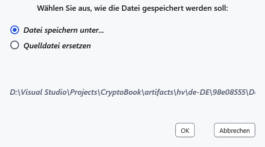
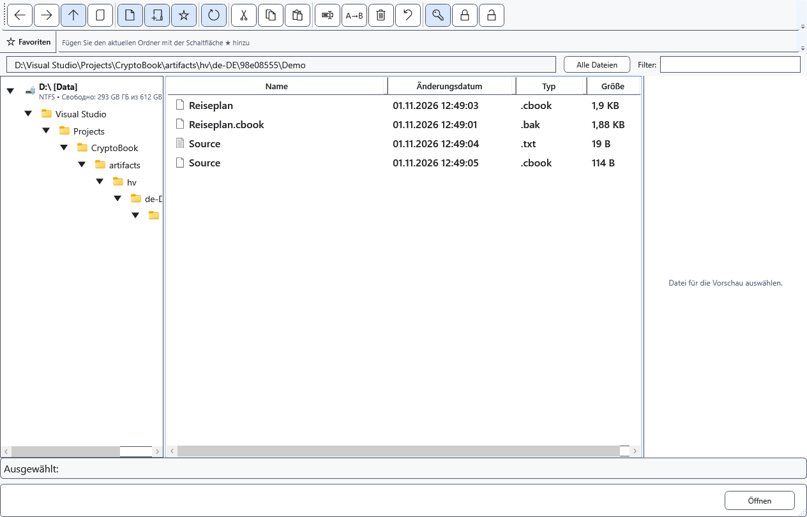

# Dokumente und Dateien schützen

Eine geschützte Kopie erlaubt die Prüfung der Verschlüsselung bei erhaltenem Original. Dieses bleibt ohne Schlüssel lesbar. Vor einem Ersetzen müssen Kennwort und eine benötigte separate Kopie gesichert sein: Abgeschlossene Verschlüsselung lässt sich nicht allgemein rückgängig machen.

## Dokument im Editor

Wählen Sie **Speichern unter**, das geschützte Format .cbook und einen Zielort. Lesen und bestätigen Sie die Warnung; geben Sie bei Bedarf einen neuen Schlüssel ein. Beim Speichern einer gewöhnlichen Datei mit gesetztem Schlüssel kann eine geschützte Kopie angeboten werden. Prüfen Sie danach den aktiven Dokumentpfad; das gewöhnliche Original wird nicht automatisch gelöscht.

## Dateien und Ordner

1. Markieren Sie Dateien oder lokale Ordner im Dateimanager und wählen Sie **Geschützte Kopien erstellen (.cbook)**. Eine einzelne Dateikopie entsteht neben der Quelle; für einen Ordner oder mehrere Elemente wählen Sie ein Ziel. Lokale Ordner werden rekursiv mit ihrer Struktur, versteckten Dateien und leeren Ordnern kopiert. Ergebnisse werden geprüft, Quellen und vorhandene Dateien beibehalten und Namenskonflikte durch eindeutige Namen gelöst. Bereits geschützte Dateien werden übersprungen. Existiert im Ziel bereits ein gleichnamiger Ordner, entsteht ein eigener nummerierter Ordner. Symbolischen Links und Junctions wird nicht gefolgt; ein gewähltes Ziel innerhalb des Quellbaums wird vom Durchlauf ausgeschlossen. Entfernte Android/MTP-Ordner werden mit diesem Befehl nicht verarbeitet.
2. Für einen anderen Modus wählen Sie **Ausgewählte Elemente verschlüsseln oder ersetzen…**. Eine einzelne Datei bietet **Datei speichern unter...** und **Quelldatei ersetzen**. Ersetzen verlangt eine Bestätigung.

3. Ein Ordner wird mit diesem Befehl nach einer Warnung rekursiv am ursprünglichen Ort verschlüsselt. Mehrere ausgewählte Elemente ersetzen ebenfalls die Quellen. Die Zusage erhaltener Originale bei geschützten Kopien gilt hier nicht. Ganze Laufwerke können nicht verschlüsselt werden; Gerätefunktionen sind gesondert zu prüfen.

## Prüfen und abbrechen

Öffnen Sie das Ergebnis mit dem richtigen Schlüssel und vergleichen Sie den Inhalt. Beim Ersetzen kann die alte Erweiterung bleiben; entscheidend sind Inhalt und erfolgreiches Öffnen. Vor der Bestätigung wählen Sie **Abbrechen**, während der Verarbeitung brechen Sie im Fortschrittsfenster ab und warten auf das Ende. Fertige Stapelelemente können verändert bleiben. Prüfen Sie bei Fehlern jedes Ergebnis, Zugriffsrechte und Platz und bewahren Sie Quellen auf.

- [Entschlüsseln](help:security.decrypt)
- [Kompatibilität](help:security.compatibility)
- [Schreibfehler](help:recovery.write)
