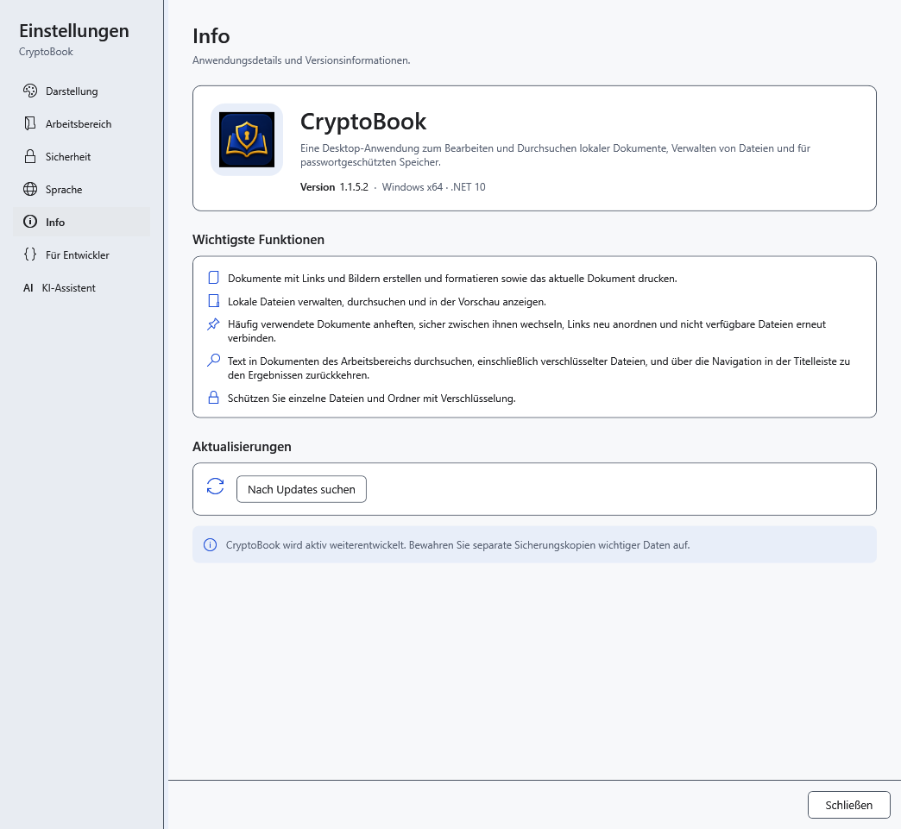
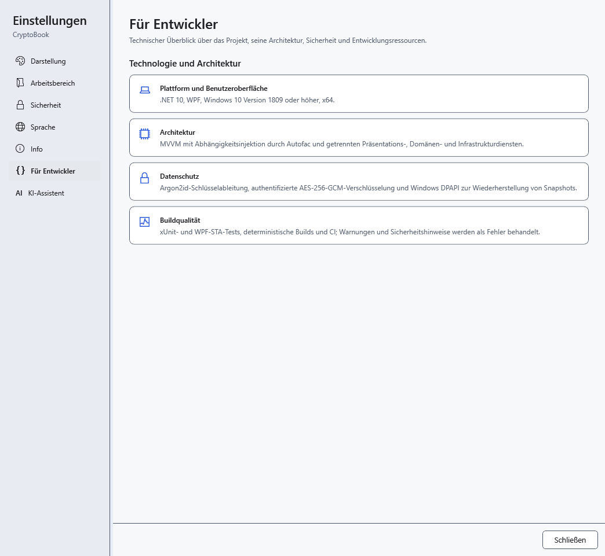

# Version und Programminformationen

Ermitteln Sie vor einer Problemmeldung die Version der **laufenden** Anwendung. Beim Start aus einem älteren portablen Ordner kann sie von der kürzlich installierten Version abweichen.

1. Öffnen Sie **Einstellungen → Info**.
2. Lesen Sie **Version** neben dem Namen CryptoBook. Nennen Sie diesen Wert, die Windows-Version und Ihre Schritte bei einer Problemmeldung.

3. **Für Entwickler** beschreibt Plattform, Architektur, Schutz und Projektprüfungen.

Diese Angaben prüfen keine konkrete Datei, keinen Computer und keine Sicherung. Ein Werkzeug zur Passwortwiederherstellung gibt es hier nicht. Die Versionsprüfung befindet sich unter **Info** im Bereich **Aktualisierungen**. Schließen Sie die Einstellungen, um weiterzuarbeiten; das Lesen verändert Ihr Dokument nicht.

- [Programmupdates](help:settings.updates)
- [Häufige Probleme](help:settings.troubleshoot)
- [Installation und portabler Betrieb](help:start.install)
