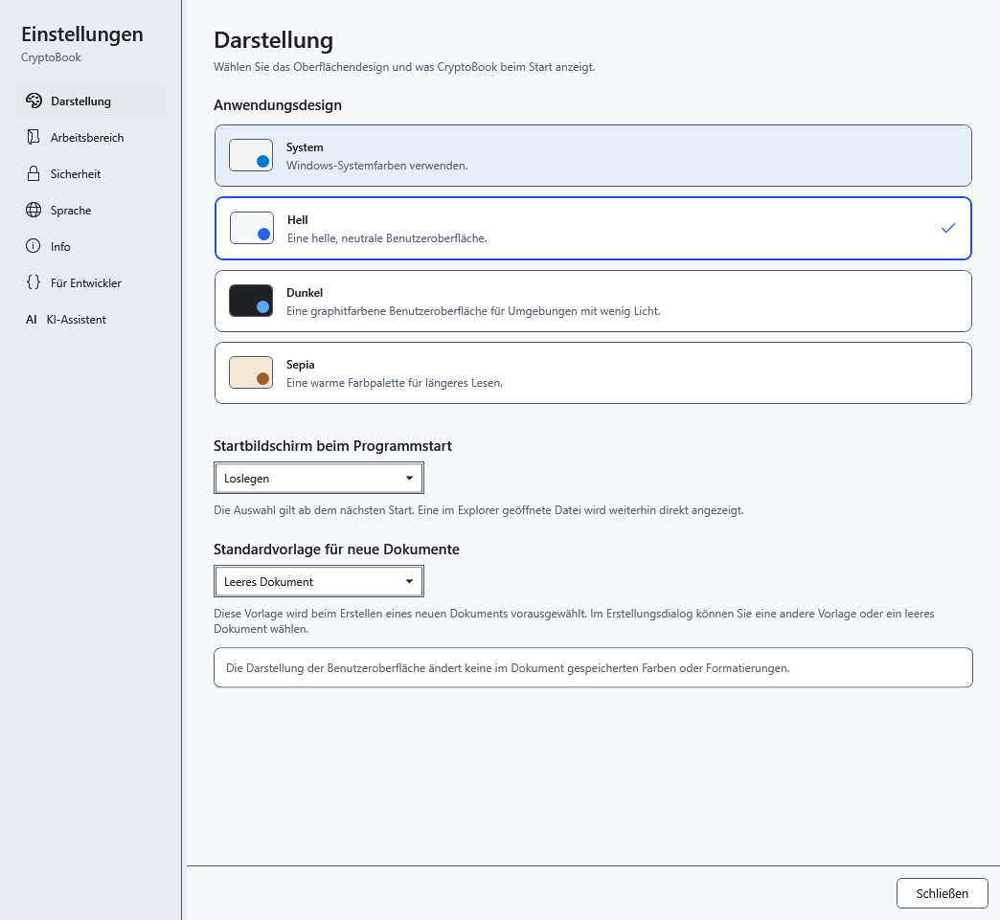
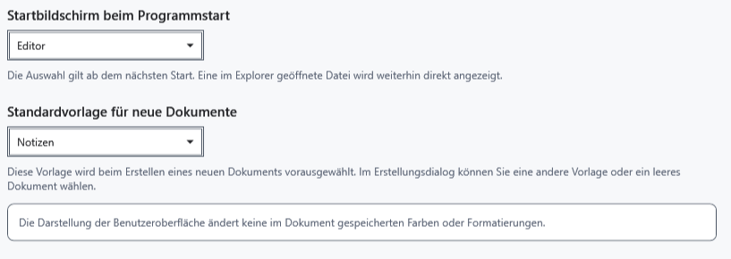

# Design, Startbildschirm und Standardvorlage

Öffnen Sie **Einstellungen → Darstellung**. Hier ändern Sie das Aussehen der Anwendung und Vorgaben für neue Arbeit. Ein geöffnetes Dokument behält seine eigene Formatierung.

## Einstellungen ändern

1. Wählen Sie **Hell**, **Dunkel**, **System** oder **Sepia**. Das Design wird sofort angewendet und gespeichert. Die Systemauswahl folgt dem hellen oder dunklen Windows-Modus.

2. Wählen Sie unter **Startbildschirm beim Programmstart** die Startseite oder den Editor. Das gilt beim nächsten Start; das Öffnen einer bestimmten Datei aus dem Explorer hat Vorrang. Das aktuelle Dokument bleibt geöffnet, der Bildschirm wechselt nicht sofort.
3. Wählen Sie unter **Standardvorlage für neue Dokumente** eine Vorlage. Sie wird beim nächsten Erstellen eines Dokuments vorgeschlagen; im Dialog können Sie weiterhin eine andere Vorlage oder ein leeres Dokument wählen.

## Prüfen und zurückkehren

Schließen und öffnen Sie die Einstellungen erneut, um die Auswahl zu prüfen. Hier gibt es keine separate Übernehmen-Schaltfläche; Schließen verwirft die Auswahl nicht. Wählen Sie zum Zurücksetzen das vorherige Design, den Bildschirm oder die Vorlage. Der linke Trenner ändert die Breite der Einstellungsnavigation.

Das Design färbt gespeicherten Text, Papierhintergrund und Bilder nicht um. Ändern Sie diese im Editor; die KI-Darstellung hat eigene Einstellungen. Wenn die Startauswahl den aktuellen Bildschirm nicht ändert, ist das erwartetes Verhalten: Speichern Sie und prüfen Sie den nächsten normalen Start.

- [Dokumentvorlagen](help:doc.templates)
- [Textfarben](help:edit.font)
- [Oberflächensprache](help:settings.language)
- [KI-Darstellung](help:ai.appearance)
