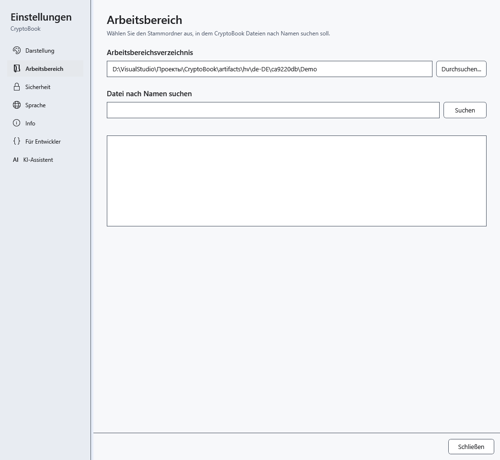

# Speicherorte für Daten und Einstellungen

Das Arbeitsverzeichnis ist Ihr Dokumentordner, nicht das vollständige CryptoBook-Profil. Installierte und portable Versionen verwenden Daten des aktuellen Windows-Benutzers außerhalb des exe-Ordners.

## Was gesichert werden sollte

| Daten | Speicherort und Bedeutung |
| --- | --- |
| Dokumente, geschützte Dateien, `.bak` | In Ihren gewählten Ordnern; eine `.bak` neben dem Original ist eine vorherige Version, kein vollständiges Änderungsarchiv |
| Design, Sprache, Startbildschirm, Vorlage, Fenster- und Hilfegrößen | `user.config` im lokalen Windows-Profil; Unterordner hängen von Version und Startpfad ab |
| Favoriten, angeheftete und zuletzt verwendete Dokumente | `%LOCALAPPDATA%\CryptoBook\favorites.json`, `pinned-documents.json`, `recent-documents.json`; Verweise und Pfade, keine Dokumentkopien |
| KI-Einstellungen, Vorlagenanweisungen und Leistungsprofile | Dort auch `ai-settings.json`, `ai-runtime-profiles.json`; GGUF und mmproj bleiben in den gewählten Ordnern |
| Updateprüfungen und übersprungene Version | Dort auch `update-check.json` |
| Suchindex gewöhnlicher Dokumente | Dort auch `Search\*.db`: kann Text gewöhnlicher Dateien enthalten; entschlüsselter Text geschützter Dokumente wird dort nicht gespeichert |
| Diagnose der Wiederherstellungssicherung | Dort auch `Logs\recovery.log`; vor dem Weitergeben auf persönliche Pfade prüfen |
| Absturzwiederherstellung / Schlüsselrücksetzungs-Schnappschuss | Unterordner `Recovery` / `Lock`; unterschiedliche Mechanismen, kein Ersatz für Sicherungen |

Geben Sie `%LOCALAPPDATA%` in die Adressleiste des Windows-Explorers ein. Bearbeiten Sie keine Dienstdateien bei laufender Anwendung. Der KI-Chat bleibt zwischen Starts nicht erhalten; übertragen Sie wichtige Antworten vorher in ein Dokument. Das Verschlüsselungspasswort lässt sich nicht aus Einstellungen wiederherstellen. Windows-geschützte Schnappschüsse hängen vom Windows-Profil ab; ein Ordnerumzug auf einen anderen Computer garantiert ihre Lesbarkeit nicht.

## Updates und Datenumzug

Speichern und schließen Sie vor Updates die Anwendung und kopieren Sie wichtige Dokumente separat. Die Anwendung versucht, kompatible Einstellungen einer früheren Version zu übernehmen; damit werden nicht alle Daten auf einen anderen Computer übertragen. Prüfen Sie danach Sprache, Design, Arbeitsverzeichnis sowie Pfade angehefteter Dateien und Modelle. Ein fehlender Verweis bedeutet keine gelöschte Datei: Suchen Sie das Original und korrigieren Sie den Pfad.

Dienst-JSON-Dateien können Pfade und eingegebene Anweisungen enthalten. Veröffentlichen Sie bei Fehlerberichten nicht das ganze Profil. Schließen Sie vor einer vollständigen Sicherung die Anwendung; löschen Sie `Recovery` oder `Lock` erst nach Prüfung der Wiederherstellung. Temporäre Update-Downloads liegen unter `%TEMP%\CryptoBook\Updates`, außerhalb des Arbeitsverzeichnisses.

- [Updates](help:settings.updates)
- [Absturzwiederherstellung](help:recovery.crash)
- [Schnappschuss nach Schlüsselrücksetzung](help:recovery.lock)
- [KI-Vorlagen](help:ai.templates)
- [Angeheftete Dokumente](help:files.pinned)
