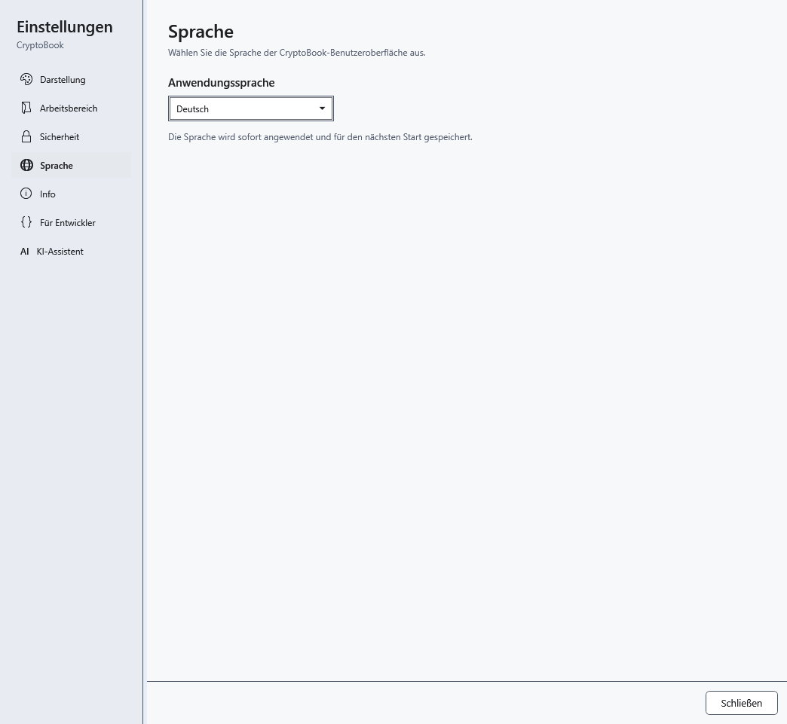

# Sprache der Anwendung und Hilfe

CryptoBook unterstützt English, Русский, Українська und Deutsch. Die Auswahl ändert Oberfläche und integrierte Hilfe; Dokumenttexte und KI-Antworten werden nicht automatisch übersetzt.

1. Öffnen Sie **Einstellungen → Sprache**.
2. Wählen Sie **Anwendungssprache**. Die Sprache gilt sofort und wird für den nächsten Start gespeichert.

## Auswirkungen auf die geöffnete Hilfe

Das gleiche Thema bleibt in seiner Übersetzung geöffnet. Suchanfrage und Ergebnisse werden geleert, Lesepositionen im Verlauf auf den Anfang zurückgesetzt. Dadurch bleiben keine Navigationsergebnisse in der alten Sprache zurück. Geben Sie eine neue Anfrage in der gewählten Sprache ein.

Schließen der Einstellungen verwirft die Auswahl nicht; wählen Sie die vorherige Sprache in derselben Liste. Bleibt ein Wort unverändert, prüfen Sie, ob es Dokumentinhalt, Datei- oder Modellname oder ein Eigenname ist: Diese Daten werden nicht übersetzt. Für KI-Antworten in einer anderen Sprache ändern Sie die Anweisung in einer Gesprächsvorlage.

- [Hilfe verwenden](help:help.use)
- [Anwendungsdesign](help:settings.appearance)
- [KI-Gesprächsvorlagen](help:ai.templates)
