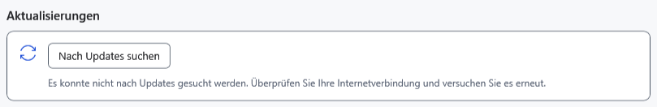

# Häufige Probleme und sichere Schritte

Speichern Sie erreichbare Arbeit zuerst separat und notieren Sie genaue Meldung, Programmversion und Schritte. Löschen Sie bei ungeklärten Fehlern weder Original noch `.bak`, `Recovery` oder `Lock`. Verwenden Sie für Versuche eine Kopie eines gewöhnlichen Dokuments.

| Anzeichen | Prüfung und Maßnahme |
| --- | --- |
| Eine Schaltfläche ist nicht verfügbar | Aktives Dokument, Auswahl, Lesemodus und laufenden Vorgang prüfen. Mehrfachumbenennung benötigt mindestens zwei geeignete Dateien. Fokus zum richtigen Fenster zurückbringen |
| Speichern schlägt fehl | Speicherplatz, Schreibrechte, Ordnerzugriff und Sperren anderer Anwendungen prüfen. In einem anderen zugänglichen Ordner speichern; Original behalten |
| Ein Dokument sieht anders aus | Erweiterung prüfen: TXT erhält keine Formatierung, Markdown speichert Quelltext. Vorschau und ausgewählten Editor prüfen |
| Ein angehefteter oder letzter Verweis fehlt | Laufwerk kann getrennt oder Datei verschoben sein. Quelle verbinden oder Pfad reparieren; ein Listeneintrag ist keine Dateikopie |
| Geschützte Datei öffnet nicht | Datei und Passwort prüfen. Falscher Schlüssel, Beschädigung und inkompatibles Format benötigen unterschiedliche Schritte; Umbenennen der Erweiterung entschlüsselt nichts. Einstellungen verraten das Passwort nicht |
| Arbeit fehlt nach Schlüsselrücksetzung | Schnappschusswiederherstellung im Dateimenü mit vorherigem Schlüssel nutzen; bei fehlgeschlagenem Schnappschuss den Prozess bis zur Rückkehr der verborgenen Arbeit offen lassen |
| Android fehlt | Gerät entsperren, USB-Dateiübertragung/MTP einschalten, Kabel und Verbindung prüfen. Verschieben nicht blind wiederholen: beide Seiten des Vorgangs prüfen |
| PDF oder Video öffnet nicht | PDF benötigt eine zugeordnete Windows-Anwendung; bei Video zählen Format und Quellenzugriff. Ein anderes Passwort behebt keine fehlende Systemzuordnung |
| KI sendet oder lädt nicht | Verfügbarkeitsgrund und Modellstatus lesen; GGUF, passenden Bildprojektor, Kontext und Speicher prüfen. Nicht ohne Ursachenprüfung wiederholt starten |
| Hilfe findet ein Wort nicht | Sprache wählen, Anfrage verkürzen oder Artikelbegriffe nutzen. Hilfesuche ist von Dokument- und Dateisuche getrennt; Inhaltsverzeichnis leert die Anfrage |

Prüfen Sie bei Updatefehlern Netzwerk, GitHub, Rechte und Platz im temporären Ordner. Führen Sie Dateien mit falscher Prüfsumme oder Signaturfehler nicht manuell aus. Scheinen Einstellungen nach Wechsel portabler Ordner zurückgesetzt, prüfen Sie laufende Version und bisheriges Profil; alte Daten bis zur Prüfung behalten.

Für eine Meldung genügen Version, Schritte, Format und ein bereinigtes Beispiel. Fügen Sie weder Passwort noch Schlüssel, vollständiges Profil, persönliche Dokumente oder Chat hinzu.

- [Schreibfehler](help:recovery.write)
- [Geräteeinschränkungen](help:devices.limits)
- [KI-Fehler](help:ai.troubleshoot)
- [Updates](help:settings.updates)
- [Benutzerdaten](help:settings.data)
