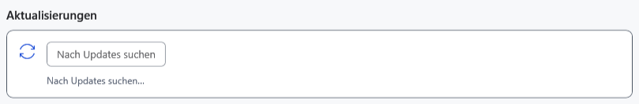
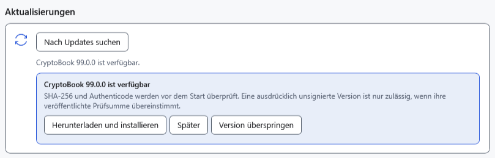

# Updates prüfen und installieren

Eine Prüfung findet neuere stabile Versionen; die Installation lädt separat ein Installationsprogramm und startet es. Speichern Sie vorher gewöhnliche und Markdown-Dokumente und kopieren Sie wichtige Dateien separat. Der KI-Chat wird zwischen Programmstarts nicht gespeichert.

## Version prüfen

1. Öffnen Sie **Einstellungen → Info** und suchen Sie **Aktualisierungen**; scrollen Sie bei Bedarf nach unten.
2. Wählen Sie **Nach Updates suchen** und warten Sie bei **Nach Updates suchen…** auf das Ergebnis.

Ohne neuere Version erscheint **Sie haben die neueste Version von CryptoBook.**. Eine Hintergrundprüfung erfolgt beim Start, wenn seit der vorherigen Prüfung mindestens 24 Stunden vergangen sind; es ist kein fortlaufender Zeitgeber. Die manuelle Prüfung umgeht dieses Intervall und eine zuvor übersprungene Version.

## Aktion wählen

- **Später** blendet die aktuelle Meldung aus, ohne eine übersprungene Version zu speichern.
- **Version überspringen** speichert genau diese Nummer und unterdrückt sie bei Hintergrundprüfungen. Eine andere neue Version wird nicht blockiert.
- **Herunterladen und installieren** lädt das Installationsprogramm. Dateiadressen der Veröffentlichung, SHA-256 und Authenticode-Status werden geprüft. Eine ausdrücklich unsignierte Veröffentlichung wird mit passender Prüfsumme zugelassen; ungültige Signaturen und abweichende Prüfsummen werden abgelehnt. Danach startet das Installationsprogramm mit erhöhten Rechten und die Anwendung beendet sich. Bei einer älteren Quelle ohne Installationsdatei kann stattdessen die Veröffentlichungsseite geöffnet werden.

Das integrierte Update verwendet auch im portablen Betrieb ein Installationsprogramm. Für ZIP-Updates folgen Sie der Installationsanleitung. Downloads nutzen den temporären Windows-Ordner; Abbruch oder Fehler stoppen den Vorgang und entfernen die unvollständige `.download`-Datei. Nach dem Start des separaten Installationsprogramms erfolgt ein Abbruch in dessen Fenster. Starten Sie nach erfolgreicher Installation CryptoBook und prüfen Sie Version, Einstellungen und Dokumente.

## Wenn Prüfung oder Installation fehlschlagen

Prüfen Sie bei **Es konnte nicht nach Updates gesucht werden. Überprüfen Sie Ihre Internetverbindung und versuchen Sie es erneut.** den Internet-/GitHub-Zugriff und versuchen Sie es später erneut. Prüfen Sie bei Downloadfehlern TEMP-Speicher und Berechtigungen. Starten Sie eine Datei nach fehlgeschlagener Integritätsprüfung nicht manuell; laden Sie erneut aus vertrauenswürdiger Quelle. Eine UAC-Ablehnung installiert das Update nicht. Löschen Sie zur Fehlerbehebung weder Profil noch Dokumente.

- [Installation und portabler Betrieb](help:start.install)
- [Benutzerdaten](help:settings.data)
- [Dokumente speichern](help:doc.save)
- [Häufige Probleme](help:settings.troubleshoot)
