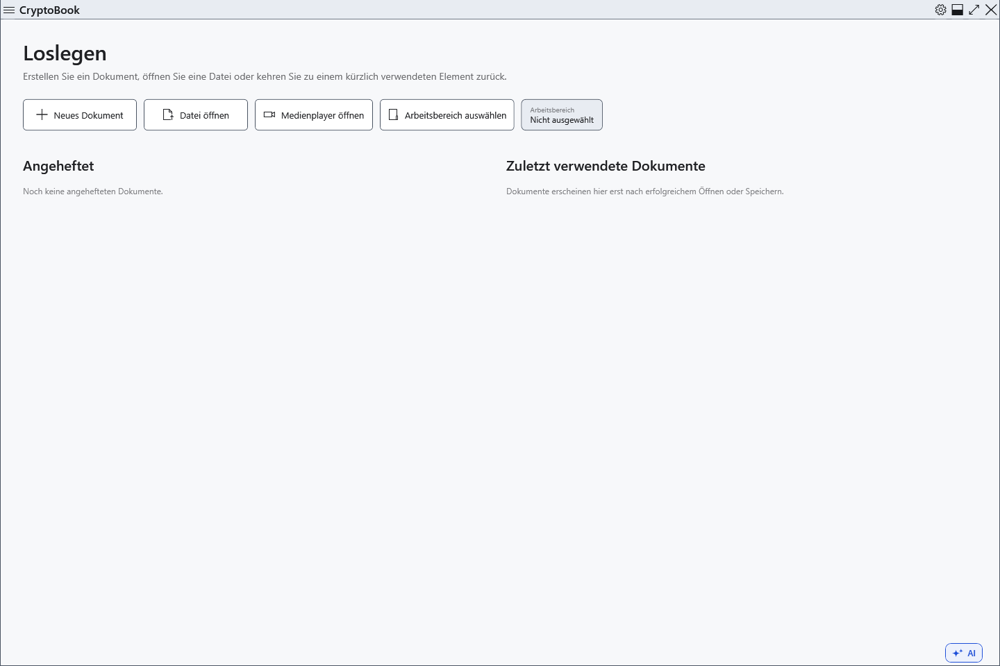

# Installation und portabler Start

CryptoBook benötigt Windows 10 ab Version 1809, x64. Offizielle Pakete enthalten die .NET-Laufzeit; eine zusätzliche Desktop Runtime ist nicht erforderlich. KI-Modelle werden separat bereitgestellt.

## Startart wählen

1. Laden Sie für eine Installation `CryptoBook-Setup-<Version>.exe` aus den Projektveröffentlichungen. Vergleichen Sie vor dem Start den SHA-256-Wert mit `SHA256SUMS.txt` derselben Veröffentlichung; `SIGNING-STATUS.txt` nennt den Signaturstatus.
2. Speichern Sie Dokumente und schließen Sie CryptoBook. Starten Sie das Installationsprogramm, bestätigen Sie die Rechteerhöhung von Windows und wählen Sie Programmordner und gegebenenfalls eine Verknüpfung. Speichern Sie persönliche Dokumente außerhalb des Installationsordners: Updates ersetzen und entfernen dort Programmdateien.
3. Entpacken Sie für den portablen Betrieb die **gesamte** `CryptoBook-win-x64.zip` in einen eigenen Ordner und starten Sie `CryptoBook.exe`. Starten Sie nicht direkt aus der ZIP und kopieren Sie nicht nur die exe ohne die übrigen Paketdateien.

Die Installation registriert CryptoBook in Windows Öffnen mit für `.cbook` und `.cbox`; die Standardanwendung wählen Sie selbst. Die portable Version führt diese Registrierung nicht automatisch aus.

## Erster Start und Updates

Öffnen Sie **Einstellungen** über die Schaltfläche in der Titelleiste. Sprache, Design und Arbeitsverzeichnis lassen sich ohne verschlüsseltes Dokument wählen. Die Verschlüsselung benötigt Ihr eigenes Passwort; die Installation erzeugt keines.

Auch die portable Version verwendet das Windows-Benutzerprofil für Einstellungen, Verlauf und Wiederherstellung. Der exe-Ordner ist keine vollständige portable Kopie Ihrer Daten. Das integrierte Update startet ein Installationsprogramm. Wenn Sie weiter ZIP-Pakete nutzen möchten, entpacken Sie das neue Paket in einen neuen Ordner und starten es dort nach dem Schließen der alten Version.

Prüfen Sie bei Startproblemen Windows-Version, x64, vollständiges Entpacken und freien Speicher in TEMP. Windows kann vor einer unsignierten Datei warnen; prüfen Sie zuerst Quelle, Prüfsumme und Signaturerklärung. Deaktivieren Sie den Windows-Schutz nicht für unbekannte Dateien. Eine installierte Kopie lässt sich über Windows deinstallieren; bewahren Sie Dokumente separat auf und sichern Sie sie selbst.

- [Oberflächeneinstellungen](help:settings.appearance)
- [Updates](help:settings.updates)
- [Benutzerdaten](help:settings.data)
