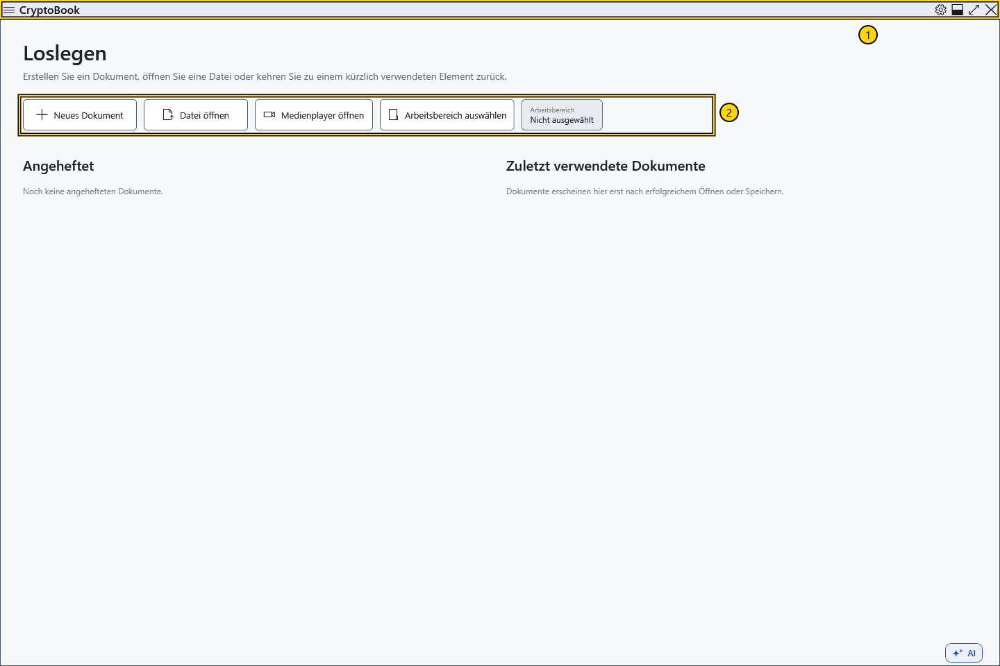
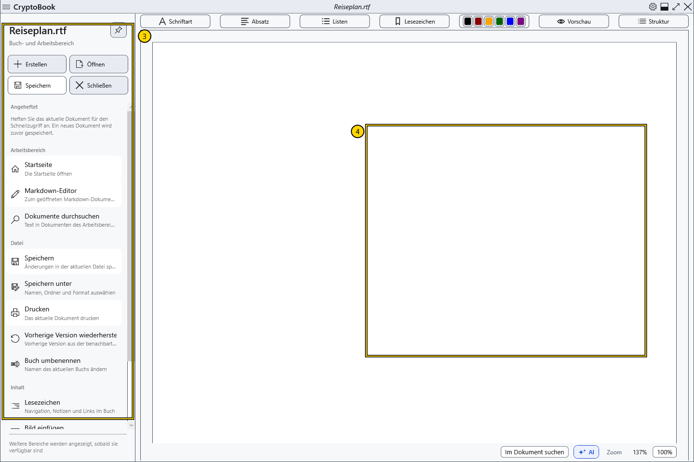
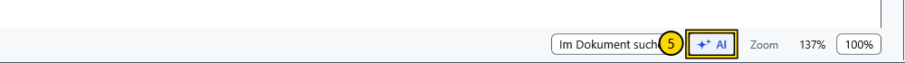

# Die wichtigsten Bereiche des Fensters

Auf dem Startbildschirm können Sie ein Dokument erstellen oder öffnen. Sobald ein Dokument geöffnet ist, dient der mittlere Fensterbereich zum Lesen und Bearbeiten.

## So finden Sie sich zurecht

1. **Obere Leiste.** Links befinden sich die Pfeile für Zurück und Vorwärts sowie die Menütaste mit drei waagerechten Linien. Die Pfeile wechseln zwischen den Seiten der Anwendung. In der Mitte steht der Dokumentname. Das Zahnrad rechts öffnet die **Einstellungen**; daneben befinden sich die Schaltflächen zur Fenstersteuerung.
2. **Startbildschirm.** **Neues Dokument** öffnet den Dialog zum Erstellen, **Datei öffnen** die Dateiauswahl und **Arbeitsbereich auswählen** die Ordnerauswahl für die Suche im Arbeitsbereich. Angeheftete und zuletzt verwendete Dokumente erscheinen hier, wenn die entsprechenden Listen Einträge enthalten.

3. **Seitenmenü.** Öffnen Sie es mit der Taste mit den drei Linien. Die Schnellaktionen enthalten **Erstellen**, **Öffnen**, **Speichern** und **Schließen**. Darunter sind weitere Befehle in **Arbeitsbereich**, **Datei** und **Inhalt** gruppiert. Öffnen Sie das Menü, um Befehle aus einer Anleitung zu finden.
4. **Dokumentbereich.** Über dem Text eines gewöhnlichen Dokuments befinden sich die Formatierungsleisten. Markdown verwendet einen eigenen Editor. Ein Seitenwechsel wandelt das eine Dokument nicht in das andere um; prüfen Sie vor dem Speichern, welcher Editor aktiv ist.

5. **Unter dem gewöhnlichen Editor.** Hier finden Sie die Dokumentsuche, die Schaltfläche **KI-Assistent** und die Zoomsteuerung. Das Assistentenfenster wird rechts eingeblendet, wenn es verfügbar ist. Zur Nutzung ist eine gesonderte Einrichtung erforderlich.

## Probieren Sie es aus

Öffnen und schließen Sie das Seitenmenü. Öffnen Sie anschließend die **Einstellungen** über das Zahnrad. Schließen Sie das Einstellungsfenster, um zum Dokument zurückzukehren. Wenn noch der Startbildschirm angezeigt wird, erstellen Sie ein Beispieldokument, um die Bedienelemente des Editors zu sehen.

## Verwandte Themen

- [Ein Dokument erstellen und speichern](help:doc.create)
