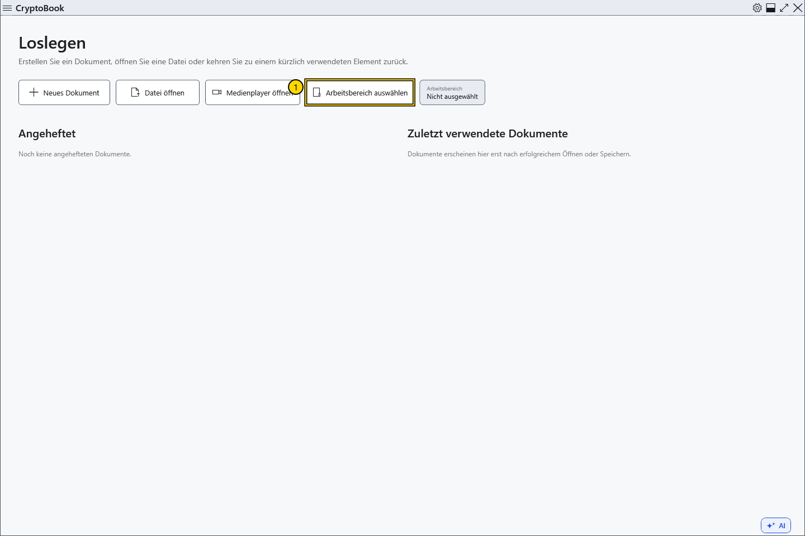
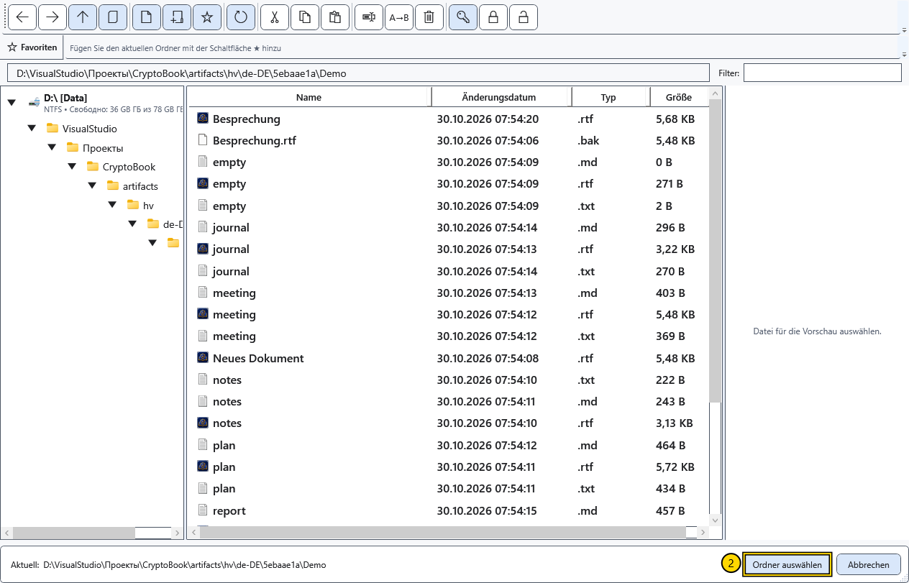
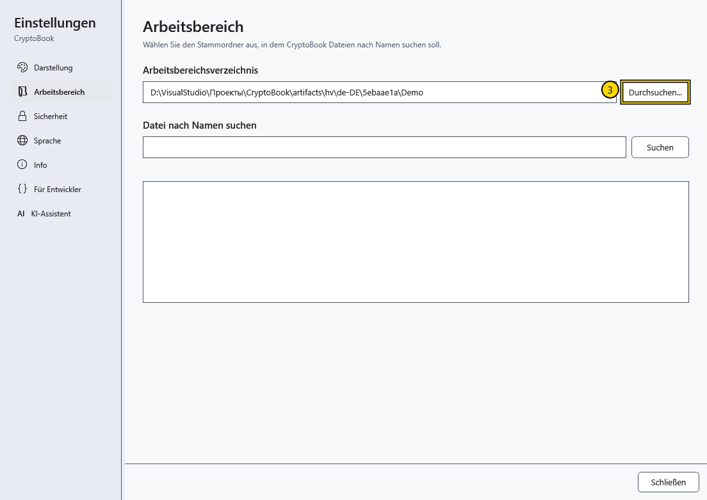

# Arbeitsverzeichnis auswählen

Das Arbeitsverzeichnis legt den Ordner für die Dokumentensuche fest. Wählen Sie beispielsweise einen Projektordner, um dessen Dateien nach Namen oder Inhalt zu suchen. Zum Erstellen oder Öffnen eines einzelnen Dokuments ist kein Arbeitsverzeichnis erforderlich.

## Vorgehen

1. Wählen Sie auf dem Startbildschirm **Arbeitsbereich auswählen**. Im Editor öffnen Sie über das Zahnrad **Einstellungen → Arbeitsbereich → Durchsuchen...**.

2. Navigieren Sie im Auswahldialog zum gewünschten lokalen Ordner. Prüfen Sie den Pfad unten und bestätigen Sie die Auswahl. **Abbrechen** behält das bisherige Arbeitsverzeichnis bei.

3. Öffnen Sie **Einstellungen → Arbeitsbereich** und prüfen Sie den angezeigten Pfad. Hier befindet sich **Datei nach Namen suchen**; die Inhaltssuche hat einen eigenen Befehl im Arbeitsbereich.

## Drei unterschiedliche Pfade

| Pfad | Bedeutung |
| --- | --- |
| Arbeitsverzeichnis | Suchbereich der Arbeitsbereichssuche |
| Aktueller Ordner im Dateimanager | Angezeigte Dateien und Ziel von Dateioperationen |
| Ordner des geöffneten Dokuments | Speicherort der Datei; **Speichern** schreibt in diese Datei |

Ein Wechsel des Arbeitsverzeichnisses verschiebt oder benennt das geöffnete Dokument nicht um und speichert es nicht im neuen Ordner. Verwenden Sie **Datei → Speichern unter**, um den Speicherort zu ändern.

## Wenn etwas nicht funktioniert

Ist der Ordner nicht verfügbar, verbinden Sie das Laufwerk oder wählen Sie einen vorhandenen lokalen Ordner. Ein leeres Suchergebnis bedeutet nicht, dass das geöffnete Dokument gelöscht wurde: Prüfen Sie zuerst Suchbereich und Namen. Mit derselben Schaltfläche können Sie einen anderen Arbeitsbereich wählen; bereits gespeicherte Dateien werden dadurch nicht gelöscht.

## Verwandte Themen

- [Bereiche des Hauptfensters](help:start.interface)
- [Dokument öffnen](help:doc.open)
- [Speichern und Speichern unter](help:doc.save)
- [Dateinavigation](help:files.navigate)
- [Suche nach Namen](help:search.name)
- [Suche nach Inhalt](help:search.workspace)
