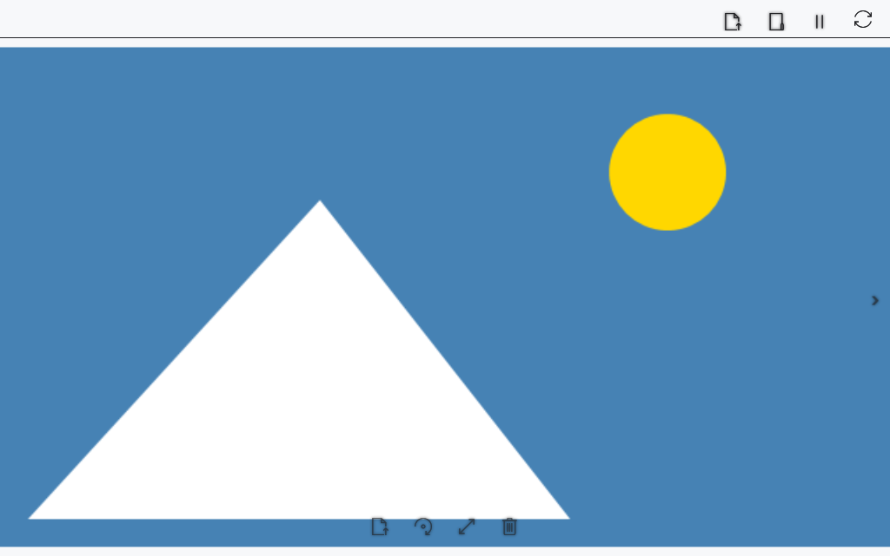

# Bilder im Mediaplayer ansehen

Der Mediaplayer öffnet ein Bild in einem eigenen Fenster. Drehen, Zoomen und Verschieben ändern die Ansicht, ohne eine neue Bilddatei zu speichern.

## Vorbereitung

> **Beim Löschen wird die Originaldatei in den Windows-Papierkorb verschoben.** Der Player zeigt zuerst eine Warnung an und fragt nach einer Bestätigung. Bei .cbook/.cbox wird die verschlüsselte Datei selbst in den Papierkorb verschoben.

Verwenden Sie eine lokale Datei oder eine lokale Kopie vom Gerät. Die Dekodierung hängt von Windows ab.

## Vorgehen

1. Öffnen Sie **Inhalt → Fotos und Videos**, wählen Sie **In diesem Player öffnen** und ein Bild. **In einem neuen Player öffnen** öffnet eine ausgewählte Datei in einem weiteren Fenster.
2. **Vorheriges Bild** / **Nächstes Bild** und ←/→ wechseln zwischen Bildern des ausgewählten Katalogs; an den Enden ist der Wechsel gesperrt.
3. **Drehen** dreht das Bild. Mausrad und ↑/↓ vergrößern/verkleinern es; Ziehen mit der linken Maustaste verschiebt es.
4. **Bild anpassen** setzt Drehung, Zoom und Verschiebung zurück.
5. Wählen Sie **Bild löschen** oder drücken Sie Entf, um die Datei zu löschen. Lesen Sie die Warnung und wählen Sie **OK**, um sie in den Papierkorb zu verschieben, oder **Abbrechen**, um die Datei zu behalten.

## Ergebnis prüfen

Das Bild erscheint im Fenster. Bildschaltflächen werden beim Darüberfahren sichtbar und haben Hinweise. Pfeiltasten ohne Zusatztasten wirken im aktiven Playerfenster auf das Bild. Nach dem Verschieben in den Papierkorb zeigt der Player ein Nachbarbild an; wenn keine Bilder mehr vorhanden sind, wird der Anzeigebereich geleert.

## Abbrechen und zurückkehren

Schließen Sie das Fenster oder öffnen Sie eine andere Datei. Wählen Sie in der Löschabfrage **Abbrechen**, um das Original zu behalten. Öffnen Sie nach dem Löschen den Windows-Papierkorb, wählen Sie die Datei und **Wiederherstellen**. Öffnen Sie die Datei anschließend erneut im Player.

## Bei Problemen

Kein Nachbarbild: Prüfen Sie Katalog und Dateireihenfolge. Versuchen Sie bei Dekodierungsfehlern ein unterstütztes Format. PDF und Video verwenden andere Anzeigewege.

Wenn das Verschieben in den Papierkorb nicht möglich ist oder fehlschlägt, meldet der Player den Fehler und belässt die Datei an ihrem Ort. Die Datei wird stattdessen nicht endgültig gelöscht.

## Verwandte Themen

- [Video und mehrere Playerfenster](help:view.video)
- [Öffnen, umbenennen und löschen](help:files.manage)
