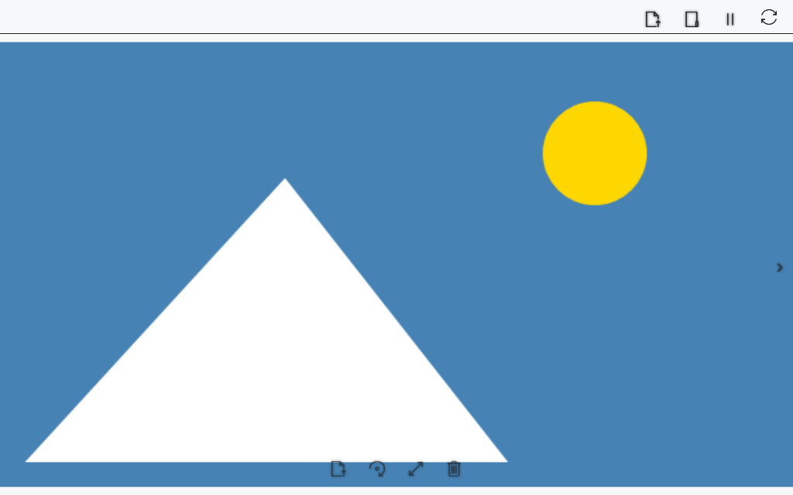

# Bilder im Mediaplayer ansehen

Der Mediaplayer öffnet ein Bild in einem eigenen Fenster. Drehen, Zoomen und Verschieben ändern die Ansicht, ohne eine neue Bilddatei zu speichern.

## Vorbereitung

> **Gelöscht wird die Originaldatei, auch die verschlüsselte .cbook/.cbox selbst, nicht eine entschlüsselte Kopie.** Zuerst prüft der Player ihre Größe und den freien Papierkorbplatz. Bei ausreichend Platz fragt er nach dem Verschieben in den Papierkorb. Fehlt der Papierkorb oder reicht der Platz nicht, bietet er endgültiges Löschen an und wartet auf eine gesonderte Zustimmung. Vor der Bestätigung wird nichts gelöscht.

Verwenden Sie eine lokale Datei oder eine lokale Kopie vom Gerät. Die Dekodierung hängt von Windows ab.

## Vorgehen

1. Öffnen Sie **Inhalt → Fotos und Videos**, wählen Sie **In diesem Player öffnen** und ein Bild. **In einem neuen Player öffnen** öffnet eine ausgewählte Datei in einem weiteren Fenster.
2. **Vorheriges Bild** / **Nächstes Bild** und ←/→ wechseln zwischen Bildern des ausgewählten Katalogs; an den Enden ist der Wechsel gesperrt.
3. **Drehen** dreht das Bild. Mausrad und ↑/↓ vergrößern/verkleinern es; Ziehen mit der linken Maustaste verschiebt es.
4. **Bild anpassen** setzt Drehung, Zoom und Verschiebung zurück.
5. Wählen Sie **Bild löschen** oder drücken Sie Entf. Warten Sie die Papierkorbprüfung ab und prüfen Sie Originalpfad und Löschart in der Warnung. Wählen Sie **OK** für die angegebene Aktion oder **Abbrechen**, um die Datei zu behalten. Erneutes Löschen und Bildwechsel sind währenddessen gesperrt. Der Fortschritt schließt nach dem Öffnen des nächsten Bildes oder dem Leeren der Anzeige.

## Ergebnis prüfen

Das Bild erscheint im Fenster. Bildschaltflächen werden beim Darüberfahren sichtbar und haben Hinweise. Pfeiltasten ohne Zusatztasten wirken im aktiven Playerfenster auf das Bild. Nach dem Verschieben in den Papierkorb zeigt der Player ein Nachbarbild an; wenn keine Bilder mehr vorhanden sind, wird der Anzeigebereich geleert.

## Abbrechen und zurückkehren

Wählen Sie in der Löschabfrage **Abbrechen**, um das Original zu behalten. Das Schließen des Players bricht noch nicht abgeschlossene Arbeit ab. Öffnen Sie nach dem Verschieben in den Papierkorb diesen, wählen Sie die Datei und **Wiederherstellen** und öffnen Sie sie erneut im Player. Nach einer bestätigten endgültigen Löschung ist keine Wiederherstellung aus dem Papierkorb möglich.

## Bei Problemen

Kein Nachbarbild: Prüfen Sie Katalog und Dateireihenfolge. Versuchen Sie bei Dekodierungsfehlern ein unterstütztes Format. PDF und Video verwenden andere Anzeigewege.

Kann das Papierkorblimit nicht ermittelt werden, wird der Vorgang mit einer Meldung beendet. Eine abgelehnte Bestätigung oder ein Fehler vor dem Löschen erhält Originaldatei und aktuelles Bild. War das Löschen beim Abbruch bereits erfolgreich, wechselt der Player zum nächsten Bild; ein Abbruch stellt eine bereits gelöschte Datei nicht automatisch wieder her.

## Verwandte Themen

- [Video und mehrere Playerfenster](help:view.video)
- [Öffnen, umbenennen und löschen](help:files.manage)
