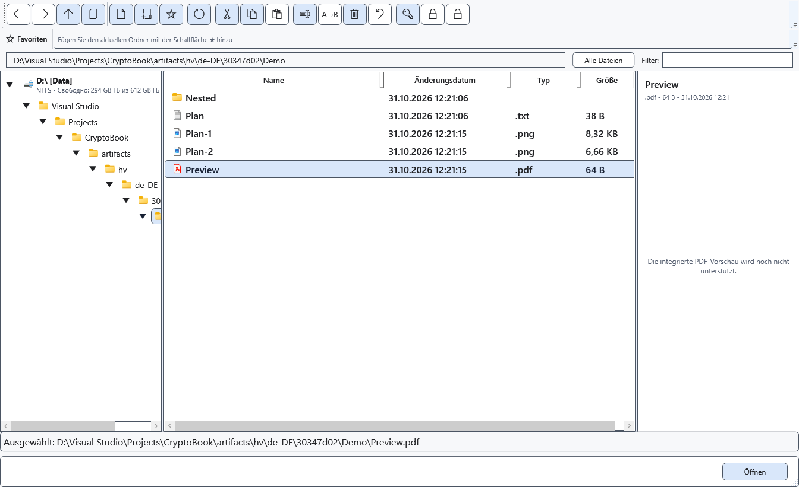

# PDF öffnen

CryptoBook übergibt normale PDF-Dateien an eine externe Windows-Anwendung. PDF wird nicht zu einem bearbeitbaren CryptoBook-Dokument; der rechte Vorschaubereich zeigt keine PDF-Seiten.

## Vorbereitung

Eine installierte PDF-Anwendung und Windows-Dateizuordnung sind nötig. Kopieren Sie Dateien von Android zuerst lokal. Übergeben Sie einen geschützten Container nicht als normale PDF-Datei an externe Programme.

## Vorgehen

1. Öffnen Sie den Dateimanager und wählen Sie eine lokale PDF-Datei. Rechts erscheint die Meldung zur fehlenden integrierten PDF-Vorschau.
2. Öffnen Sie die Datei mit **Öffnen**. Windows startet die zugeordnete PDF-Anwendung.
3. Lesen, drucken oder bearbeiten Sie dort. Aktivieren Sie CryptoBook, um zurückzukehren.

## Ergebnis prüfen

Bei vorhandener Zuordnung erscheint das Dokument extern. Der Inhalt des normalen CryptoBook-Editors wird nicht durch PDF-Seiten ersetzt.

## Abbrechen und zurückkehren

Schließen Sie das externe Fenster oder kehren Sie zu CryptoBook zurück. Eine Speicherabfrage für dortige Änderungen gehört zur externen Anwendung.

## Bei Problemen

Richten Sie bei einem Öffnungsfehler die Windows-Standardanwendung für PDF ein und versuchen Sie es erneut. Eine andere Erweiterung macht PDF nicht in CryptoBook bearbeitbar. Entschlüsseln Sie geschützte PDF zuerst ausdrücklich an einen geeigneten Ort; die Ergebnisdatei ist unverschlüsselt.

## Verwandte Themen

- [Dokument öffnen](help:doc.open)
- [Formate und Kodierungen](help:doc.formats)
