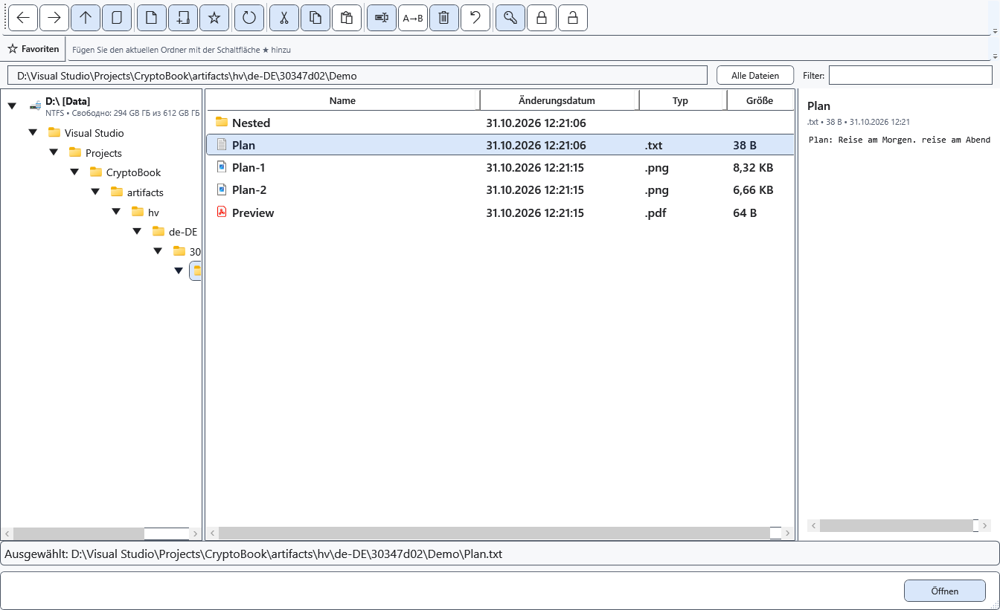
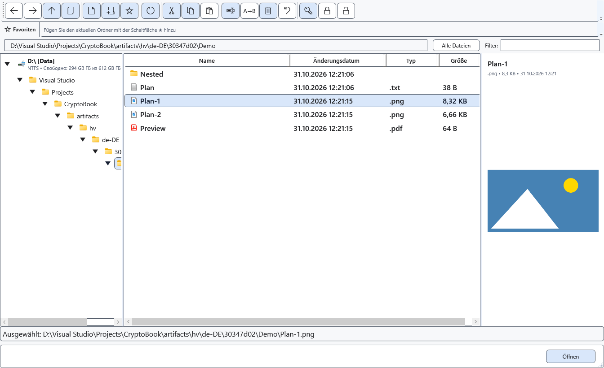

# Dateivorschau im Dateimanager

Der rechte Bereich des Dateimanagers zeigt Text oder ein Bild, ohne einen eigenen Editor zu öffnen.

## Vorbereitung

Wählen Sie eine einzelne Datei. Eine lokale geschützte Datei benötigt einen bereits eingegebenen passenden Schlüssel. Die Android-Vorschau liest den ursprünglichen Datenstrom und entschlüsselt ihn nicht automatisch.

## Vorgehen

1. Öffnen Sie den Dateimanager und wechseln Sie in einen Ordner.
2. Wählen Sie eine Datei in der Liste. Rechts sehen Sie Name, Typ, Größe und Inhalt oder eine Meldung zur Einschränkung.
3. Wählen Sie eine andere Datei, um die Vorschau zu ändern. Zum Bearbeiten oder vollständigen Anzeigen öffnen Sie die Datei mit dem passenden Befehl.

## Ergebnis prüfen

Die Textvorschau unterstützt TXT, LOG, MD, CS, XAML, JSON, XML, YAML/YML, INI, CONFIG, CSV und TSV und liest die ersten 512 KiB. Für PNG, JPG/JPEG, BMP, GIF und WEBP gilt eine Grenze von 32 MiB; die Dekodierung hängt von Windows ab. Dies ist keine vollständige RTF- oder PDF-Anzeige.

## Abbrechen und zurückkehren

Wählen Sie einen Ordner oder eine andere Datei oder schließen Sie das Fenster. Die Vorschau schreibt keine Änderungen in die Datei.

## Bei Problemen

Zu große Dateien, nicht unterstützte Formate, ein falscher Schlüssel oder ein getrenntes Gerät führen zu einer Meldung. Die lokale geschützte Vorschau ist auf 32 MiB und unterstützte Inhalte begrenzt. Entschlüsseln Sie eine geschützte Gerätedatei ausdrücklich oder kopieren Sie sie zuerst lokal.

## Verwandte Themen

- [In Ordnern navigieren](help:files.navigate)
- [Möglichkeiten und Grenzen von Geräten](help:devices.limits)
- [Bilder im Mediaplayer ansehen](help:view.images)
