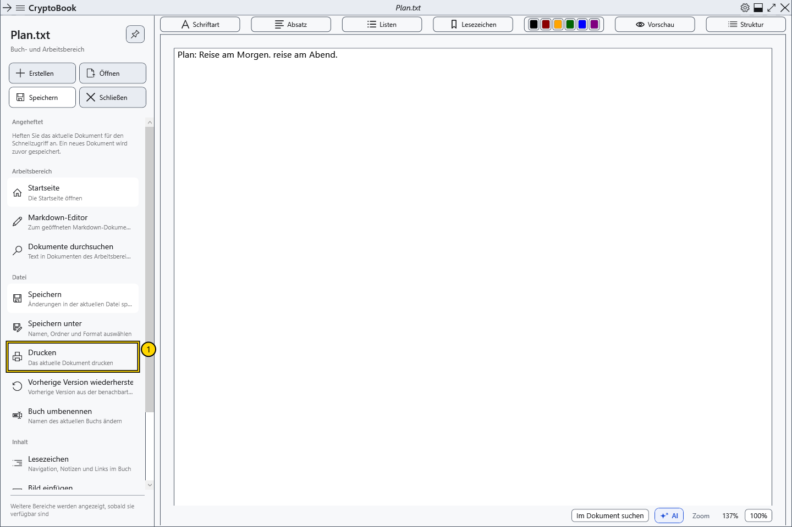

# Das aktuelle Dokument drucken

Drucken übergibt das aktuelle Dokument an den Systemdialog. Normale Dokumente behalten ihre Formatierung; Markdown wird zunächst in ein dargestelltes Dokument umgewandelt.

## Vorbereitung

Aktivieren Sie das gewünschte normale oder Markdown-Dokument mit druckbarem Inhalt. Prüfen Sie Drucker, Papier und Geräteverfügbarkeit. Drucken kann geschützte Inhalte auf Papier oder in einer Ausgabedatei offenlegen.

## Vorgehen

1. Wählen Sie im Seitenmenü **Datei → Drucken**.
2. Wählen Sie im Windows-Dialog den Drucker und verfügbare Optionen. Sprache und Felder hängen von Windows und Treiber ab.
3. Prüfen Sie das Ziel und bestätigen Sie den Druck oder brechen Sie den Systemdialog ab.

## Ergebnis prüfen

Nach Bestätigung wird der Auftrag an den Drucker gesendet. Sein bedruckbarer Bereich bestimmt die Gestaltung und kann von der Bildschirmanzeige abweichen. Das aktive Dokument wird insgesamt gedruckt; eine Textauswahl begrenzt den Umfang nicht automatisch. Drucken Sie PDF im externen Betrachter.

## Abbrechen und zurückkehren

Abbrechen vor der Bestätigung sendet keinen Auftrag. Nutzen Sie nach dem Senden die Windows-Druckwarteschlange oder Druckersteuerung; das Schließen von CryptoBook garantiert keinen Abbruch.

## Bei Problemen

Befehl gesperrt: Prüfen Sie Dokument und Inhalt. Prüfen Sie bei Druckfehlern Treiber, Warteschlange und Verbindung. Eine Bildschirmvorschau bestätigt weder physischen Druck noch die genaue Papiergestaltung.

## Verwandte Themen

- [Seiteneinstellungen und Papierfarbe](help:edit.page)
- [Vorschau, Seiten und Zoom](help:edit.view)
