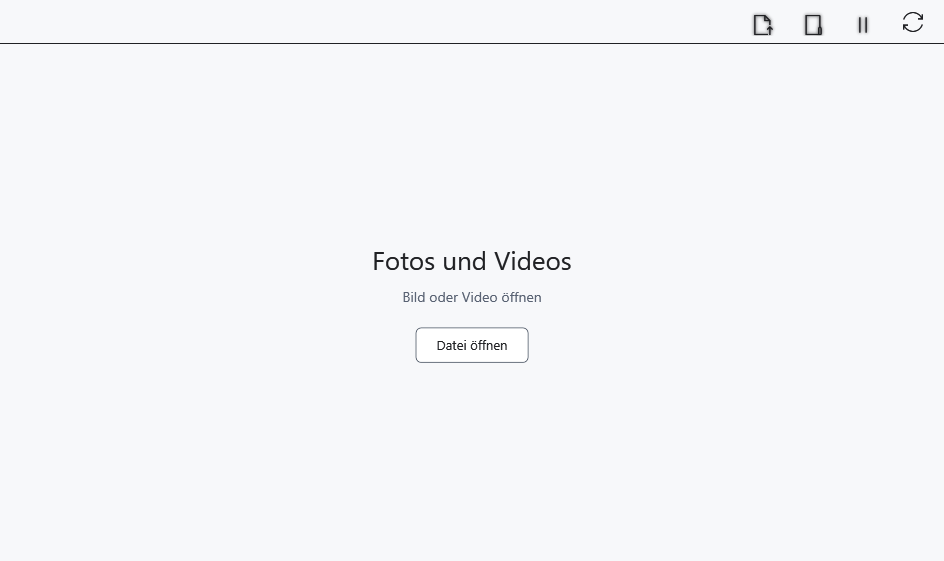

# Video und mehrere Playerfenster

Der Mediaplayer öffnet Video in einem eigenen Fenster. Unterstützung hängt von Container, Codec und verfügbarer Dekodierung ab; die Erweiterung allein garantiert keine Wiedergabe.

## Vorbereitung

Verwenden Sie ein lokales Video oder eine lokale Gerätekopie. Öffnen Sie das Fenster über **Inhalt → Fotos und Videos** oder die Schaltfläche der Startseite.

## Vorgehen

1. Wählen Sie **In diesem Player öffnen** und ein Video. **In einem neuen Player öffnen** öffnet eine ausgewählte Datei in einem weiteren Fenster.
2. Nutzen Sie die Flyleaf-Steuerung im Videobereich für Wiedergabe/Pause, Zeitleiste und Ton. Bewegen Sie den Zeiger darüber, wenn die Steuerung verborgen ist.
3. Mit Fokus im Videobereich spulen ←/→; Alt+←/→ wechseln zum vorherigen/nächsten Video des Katalogs, falls vorhanden.
4. **Alle Player anhalten** pausiert die Player. **Wiedergabe synchronisieren (experimentell)** verbindet Fenster experimentell; deaktivieren Sie dies für unabhängige Steuerung.

## Ergebnis prüfen

Bei erfolgreicher Wiedergabe erscheinen Videobilder und die Position läuft weiter. Nachbarvideos stammen aus dem gewählten Katalog, nicht aus allen Videos des PCs. Synchronisierung verspricht keine genaue Bildgleichheit zwischen Fenstern.

## Abbrechen und zurückkehren

Pausieren Sie, öffnen Sie eine andere Datei oder schließen Sie das Fenster. Das Schließen löscht kein Video. Ausschalten der Synchronisierung ermöglicht wieder unabhängige Steuerung.

## Bei Problemen

Kein Bild oder Fehler: Prüfen Sie eine lokale Kopie, Dateiintegrität und Codec-Unterstützung. Tasten wirken je nach Fokus; Editor-Kürzel gelten nicht automatisch für Flyleaf. Zeitleiste und weitere Befehle können die eigene Gestaltung des Players verwenden.

## Verwandte Themen

- [Bilder im Mediaplayer ansehen](help:view.images)
- [Möglichkeiten und Grenzen von Geräten](help:devices.limits)
