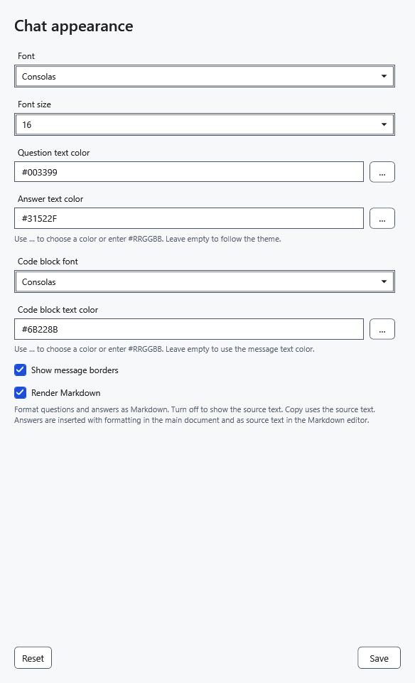
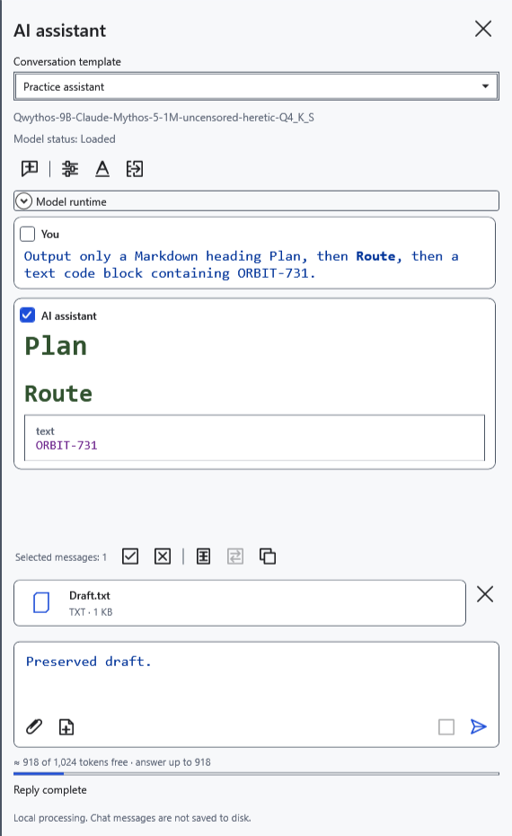
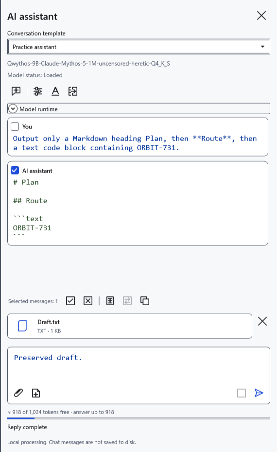
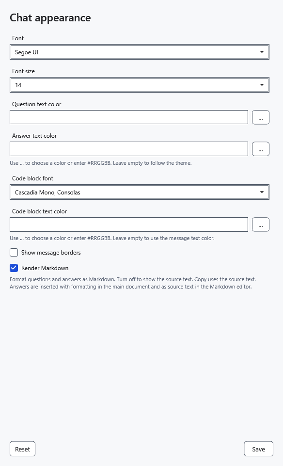

# AI chat appearance

Fonts, colors and Markdown change chat display while retaining the original reply, conversation, draft and attachments. Appearance settings are shared across models. Saving them does not unload the model or stop an active reply.

## Change appearance

1. Click **Chat appearance**, the A icon at the top of the assistant panel.
2. Choose **Font** and **Font size**, from 8 to 40. These apply to messages, the question field and reasoning. Code blocks have a separate font.
3. Set question, answer and code colors using **#RRGGBB**, for example `#31522F`. The color button opens a system dialog. An empty color field uses the theme color; an empty code color inherits the corresponding message color.
4. Enable **Show message borders** if desired. Borders are off by default.

5. Click **Save**. Existing replies redraw with the selected appearance.

## Markdown and source text

**Render Markdown** defaults to on: headings, lists, tables and code appear formatted. Turn it off and save to see original Markdown with its markup characters.

**Copy** uses original reply text in either mode. This option does not control formatted transfer into the ordinary editor, which follows its own rules. HTML is not executed and external Markdown images are not loaded. Formatting does not make generated code safe to run.

## Reset and discard

6. Open the window and click **Reset**: default settings appear — size 14, no borders, Markdown on and theme colors. Click **Save** to apply them.

Closing the window without saving discards edits, including Reset. If a color is invalid, correct it or clear the field and save again. If a font is absent from the list, choose an installed font. Increase font size if text is too small; these settings do not change document text size.

- [Chat and copying](help:ai.chat)
- [Apply a reply to a document](help:ai.apply)
- [Application appearance](help:settings.appearance)
