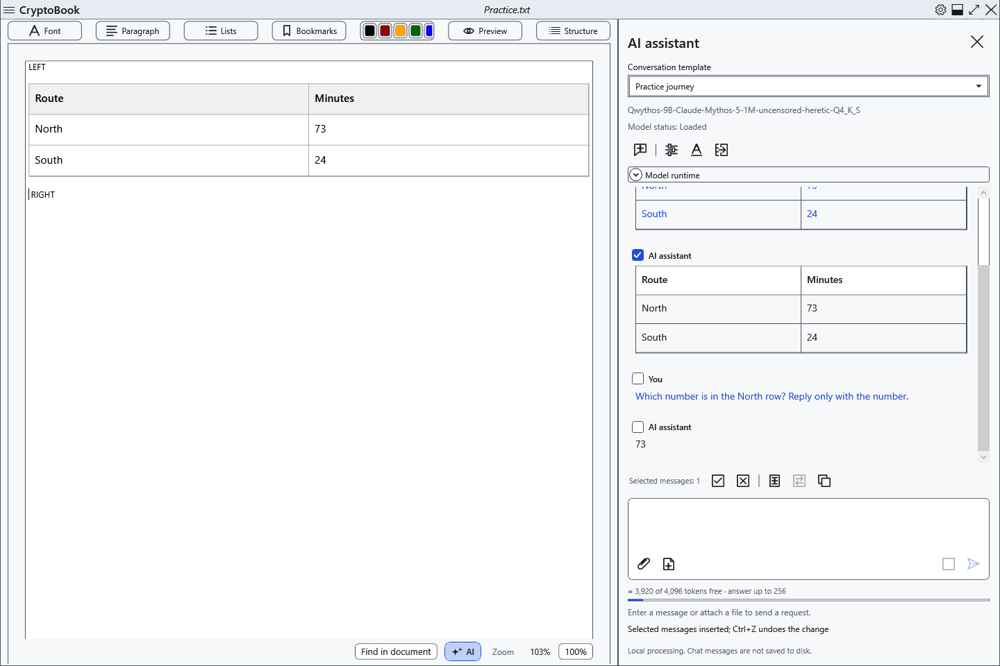
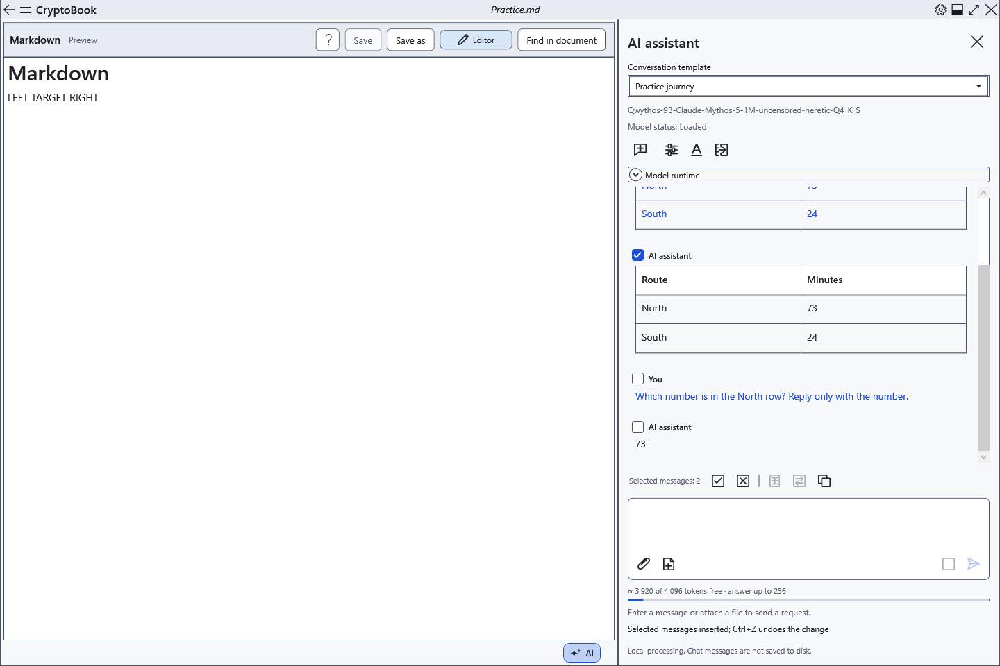
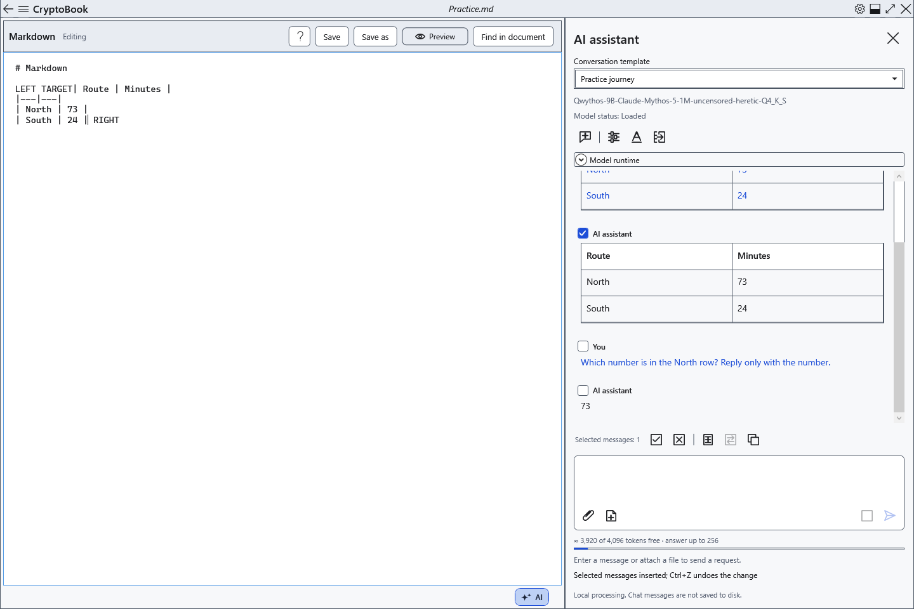

# Transfer replies to a document

**Insert selected** and **Replace selection** transfer checked chat messages to the current editor. You can choose the document, cursor and selection after receiving the answer. Review model output before transferring it.

## Ordinary editor

1. Check the needed messages in the AI panel. A single message has no added label; multiple messages follow conversation order with participant labels and separators. Reasoning and attachment contents are excluded.
2. Open an ordinary document for editing. Place the cursor or select text.
3. Click **Insert selected**. The reply appears at the cursor, or after the selection when text is selected. The selected text remains.

4. To replace text, check the selection first: the command removes that exact text. Click **Replace selection**. It is unavailable without a selection.

The ordinary editor converts Markdown into editable headings, emphasis, lists, code and tables. Cells can be edited independently without changing the original chat reply. Repeated insertion remains available and adds the content again. HTML is inert; images in AI markup are not loaded. Insert image files using the editor's own tools.

## Markdown

5. Switch to the intended Markdown document. If **Preview** is open, click **Editor**. Both transfer commands are unavailable in preview.

6. Place the cursor or selection in the source and use the same command. It inserts original Markdown from the checked messages, rather than a formatted WPF fragment. Switch to **Preview** to inspect the result.

Line breaks are not added automatically. Prepare block boundaries in the source for a separate table or heading: inserting mid-line can leave the markup displayed as plain text.

## Check, undo and save

Transfer changes the document in memory without automatically writing the file. Check the insertion point and surrounding text. One Ctrl+Z in the corresponding editor reverses the complete insertion or replacement; Ctrl+Y repeats it. Then save normally. Choose an appropriate ordinary-document format to preserve formatting; TXT retains text only.

If nothing is checked, select messages. For unavailable insertion, open an editable document, leave preview or reading mode and wait for the reply to finish. Workspace locking prevents transfer. If the document changed during application, read the error and check the target again; do not rely on an old cursor in another document.

- [Select messages](help:ai.chat)
- [Document tables](help:content.tables)
- [Edit Markdown](help:md.edit)
- [Document formats](help:doc.formats)
- [Save](help:doc.save)
