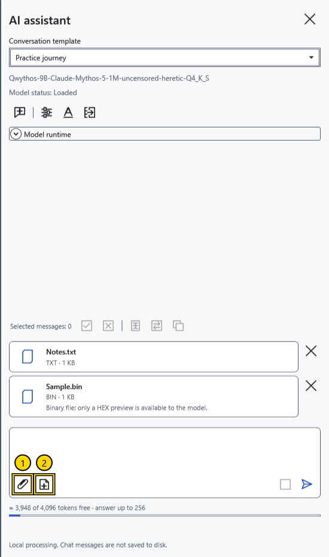
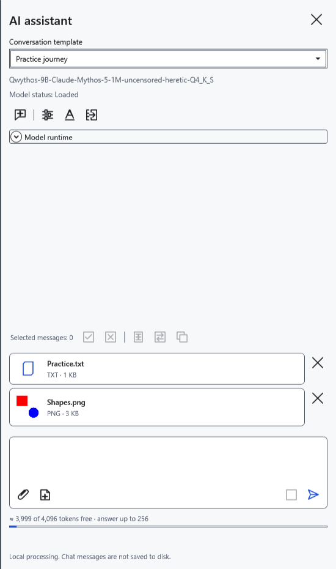
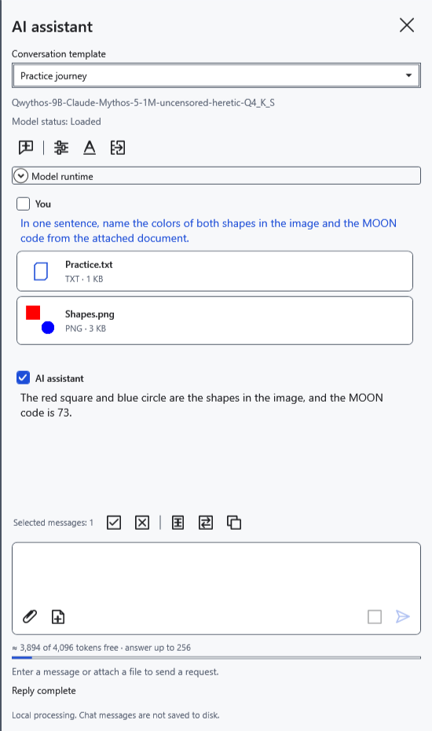
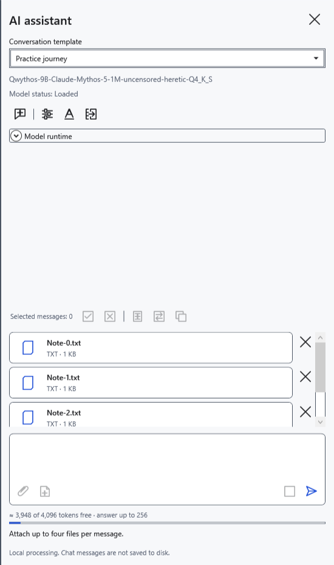

# Attach files and the current document

Attachments supply information for a question. Choose files you intend to share with the local model. A file card does not establish that the program has extracted its entire contents.

## Add and remove

1. Click **Attach files…** (1) beside the prompt. The system picker offers documents/images and **All files (*.*)**. Select several files or drag files onto the panel.
2. Check the cards. Before sending, the **Remove attachment** cross removes the corresponding card.

Text, Markdown, RTF, DOCX and XamlPackage are supplied as extracted text. Formatting and embedded document images do not become vision inputs. For an unknown extension, the program tries reading text; a binary file receives a limited HEX preview of its first 256 bytes, name and size. This does not fully parse PDF, archives or other binary formats. For a protected document, open it normally first and attach the current-document snapshot.

## Attach a document and image

3. Open the intended document and click **Current document** (2). This attaches the whole document's text at that moment, including unsaved edits, rather than only the selection. For Markdown it is the source text. Later edits do not update an existing card: remove it and attach again.
4. For an image, attach a separate PNG/JPEG/BMP/GIF/TIFF. A vision-capable model and exactly one compatible mmproj beside its GGUF are required.

5. Enter a question and click **Send**. With no question text, a default file question is used. Sent cards move into history; follow-ups in the same chat use those attachments.

## Limits and errors

Up to four files per message; up to 32 MB per file; up to 500000 extracted text characters; up to 100 megapixels before image resizing. Large images are reduced for processing and fine details may be lost. Attachments and history occupy model context: an allowed file can still exceed a particular request's budget.

After a limit error, earlier cards remain: remove extras and retry. Empty or oversized files, read errors and damaged images are not added. Wait while files are being read or a reply is running. Sent attachments cannot be removed individually from history; **New chat** deletes the entire conversation, draft and attachments without archiving. Preserve needed replies first. Exiting the application and resetting the key also discard attachments.

- [Chat](help:ai.chat)
- [Model and vision projector](help:ai.models)
- [Transfer replies](help:ai.apply)
- [Assistant errors](help:ai.troubleshoot)
- [Context](help:ai.context)
