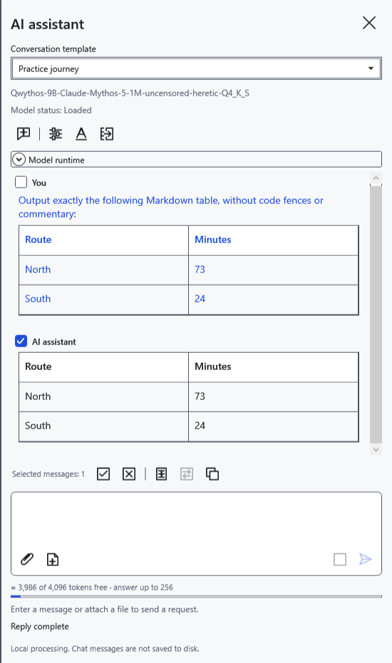
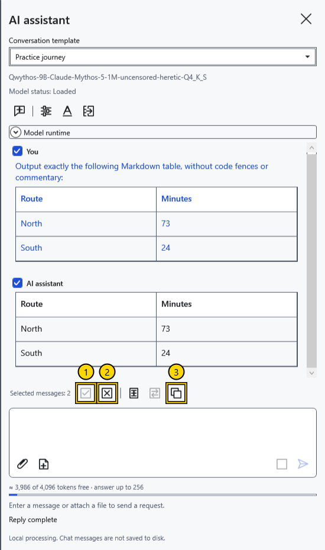
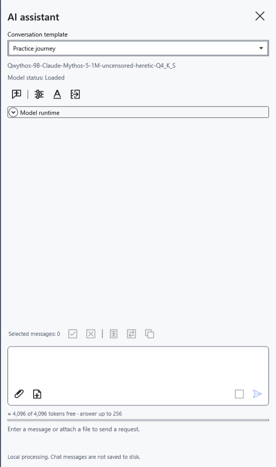

# Chat with the assistant and select messages

The chat is in the AI panel on the right. Questions, replies and sent attachments form the current history for later requests. Message checkboxes control copying and transfer to the editor; unchecked messages still belong to the model's context.

## Send a question

1. Enable the assistant and choose a model. Enter a question at the bottom of the panel.
2. Click **Send** or press Ctrl+Enter in the prompt. Enter alone adds a new line. Wait for completion or click **Stop** while a reply is being generated.
3. Read the reply and check its facts. Ask a follow-up in the same chat to use the previous conversation.

Replies appear progressively. If the model provides separate reasoning, expand **Model reasoning** to view it; it remains separate from the final answer. For an empty reply, read the status message. Reasoning settings depend on the model.

## Select and copy

Check messages beside **You** and **AI assistant**. You can select questions, answers or several messages. The latest nonempty reply is selected automatically until you change the selection manually; manual selection survives the next request.

1. **Select all** checks every message with nonempty text.
2. **Clear selection** removes the checks and disables copying and transfer.
3. **Copy** places the original text of selected messages on the clipboard.

A single message has no added label. Multiple messages follow conversation order with participant labels and separators. Original Markdown is preserved even when the chat shows a formatted table. Reasoning and attachment contents are excluded. **Insert selected** and **Replace selection** use the same checked messages.

## Start again

Transfer needed replies to a document before **New chat**: it deletes the conversation, draft, attachments, selection and computation cache without archiving. Loaded model weights remain in memory; hiding the panel does not archive the chat either. Messages do not persist across application restarts and are cleared when resetting the key.

If copying fails, read the status and retry. When sending is unavailable, read the explanation below the prompt.

- [Enable the assistant](help:ai.start)
- [Conversation templates](help:ai.templates)
- [Attachments](help:ai.attachments)
- [Transfer replies to a document](help:ai.apply)
- [Stop and unload](help:ai.lifecycle)
