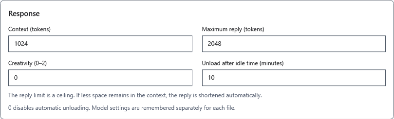
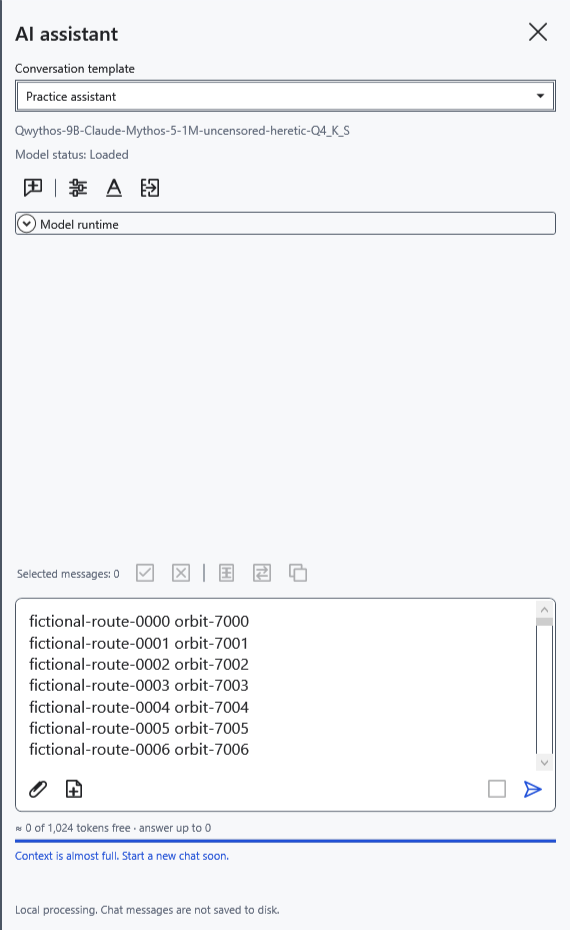
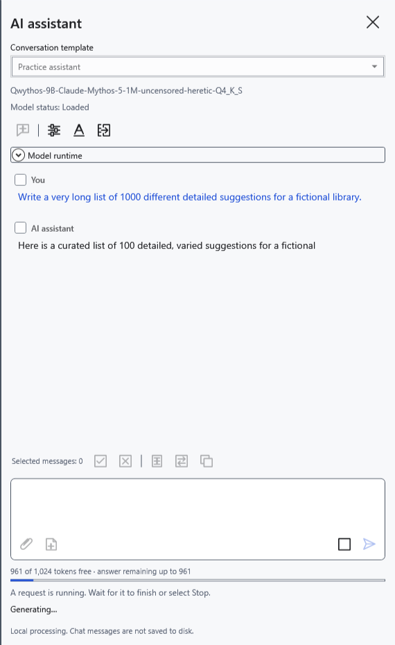
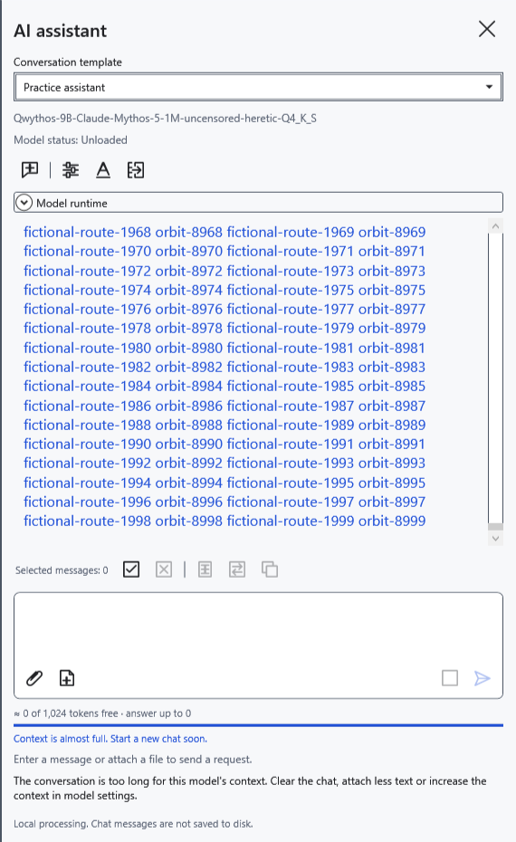
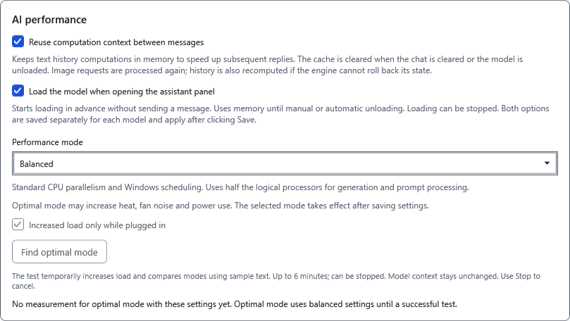
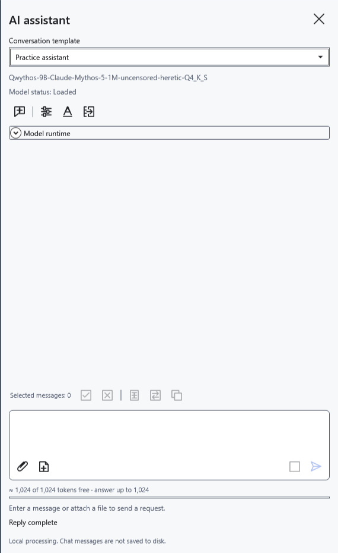

# Context, reply limit and preloading

Context is one shared token window for template instructions, history, the question, attachments and the new reply, including reasoning. A token is not the same as a character or word. Only the unused part of this window is available for a long reply.

## Set the limits

1. Open **Model settings**, select the intended GGUF and scroll to the reply parameters.
2. Set **Context (tokens)** to 512–131072, within the model's capabilities and the computer's memory. A larger value needs more memory and does not automatically improve the model.
3. Set **Maximum reply (tokens)** to 1–131072. This is a ceiling, not a request for an exact amount of text. It may exceed context, but the actual reply is still bounded by free context. The model may finish earlier.
4. **Creativity (0–2)** affects the choice of continuation; it is not a speed control. Click **Save**. Changing reply parameters starts a new chat: copy any needed text first.

Reply parameters are saved separately for each model file. Conversation templates are shared: switching a template does not create another model.

## Read the indicator

Before sending and after completion, **≈** means an estimate. It includes the current draft and attachments, but may differ from the model's tokenizer. An empty new chat shows the whole free window, although future instructions will also occupy space.

During generation the indicator uses actual engine data: input and already emitted tokens, including reasoning. The reply allowance decreases as generation progresses. If automatic memory mode reduced context, **Model runtime** shows the effective size; the saved input field alone does not describe it.

If the actual request does not fit, a context-full message appears. The estimate does not guarantee successful submission. Reduce the question/attachments or start **New chat**. This deletes messages, draft and attachments without archiving and clears the computation cache, while retaining loaded weights. Copy needed replies first.

## Reuse and preload

**Model settings → AI performance** has two independent options. Both default to off and take effect after **Save**, separately for the selected model.

- **Reuse computation context between messages** retains calculations for an identical text prefix of the next request. Gains depend on the model and matching prefix; editing instructions or an early message may require recalculation. If the engine cannot roll back this model's state, history is also recomputed. Images are processed again. This does not enlarge context, provide lasting memory or archive chats. New chat and unloading clear the cache.
- **Load the model when opening the assistant panel** loads weights when the panel opens. It sends no question, but already occupies memory. Stop loading or unload the model when needed. Opening the panel again may trigger another preload.

Before saving, use **Cancel** or close the window to discard edits. To revert, turn the options off and save; to release memory immediately, click **Unload model**. Closing the panel normally retains weights.

- [Chat and a new question](help:ai.chat)
- [Memory modes](help:ai.memory)
- [Loading and unloading](help:ai.lifecycle)
- [Conversation templates](help:ai.templates)
