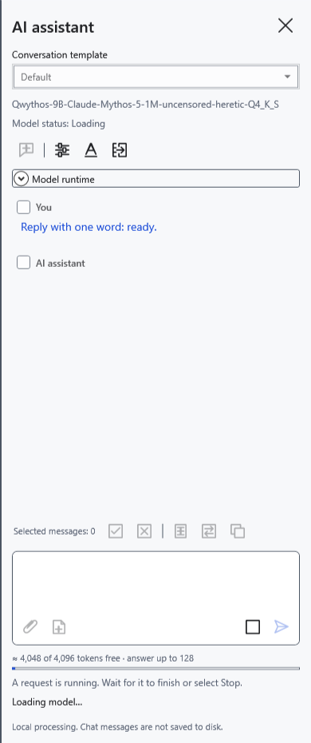
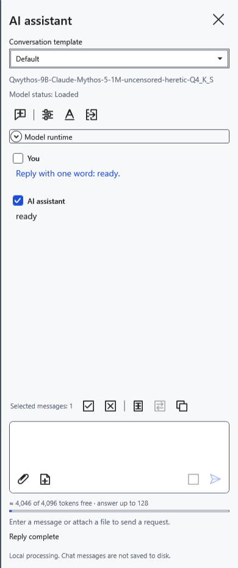
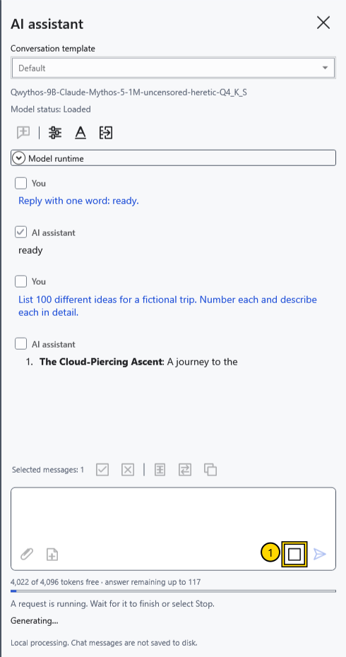
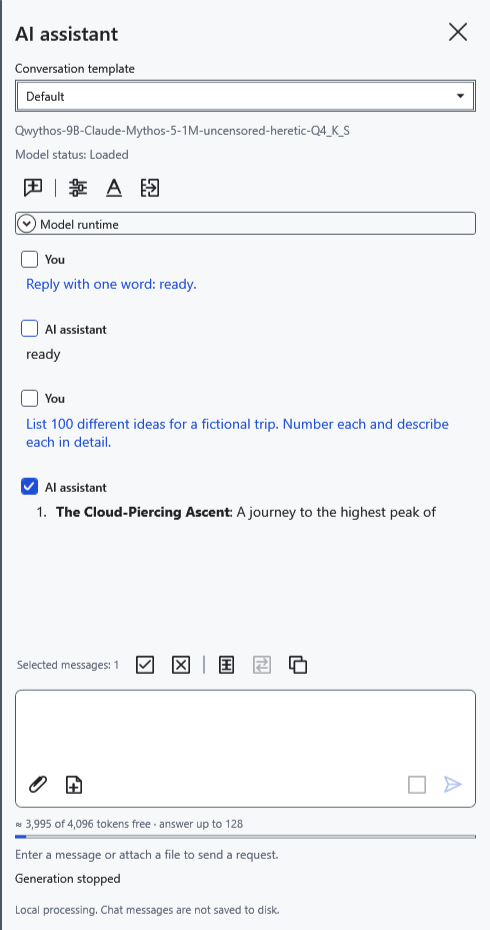
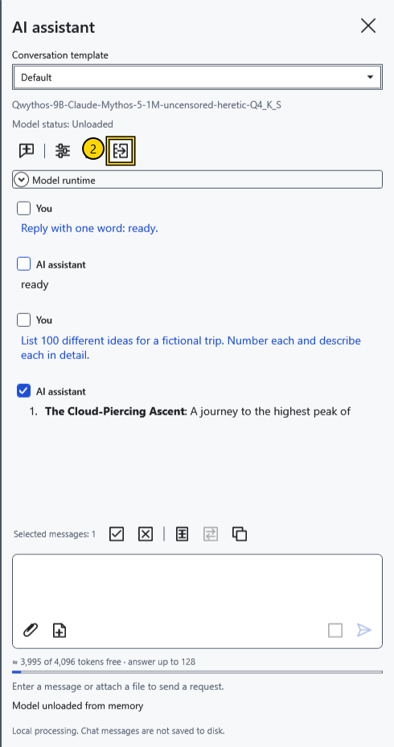

# Loading, stopping and unloading a model

**Model status** below the model name describes its weights. Operation progress and errors appear separately. **Loaded** does not mean a reply is still being generated: the model may simply be waiting for the next request.

## Loading and reply completion

Choose and save a model, then send a question. The first request normally loads its weights. If **Load the model when opening the assistant panel** is enabled, opening the panel starts loading instead. Loading and generation can occupy memory and the processor.

Wait for the reply to finish. **Send** becomes available again when you enter another question; the weights stay loaded for the next turn.

## Stop the current reply

1. While generating, click **Stop** (1) beside the prompt.

Wait for stopping to finish. Received text remains in the chat and may end in the middle of a sentence. A normal cooperative stop retains the weights. Cancelling initial loading instead releases the model. If the separate model process does not acknowledge cancellation within about five seconds, CryptoBook terminates it; the next request must load the model again.

## Release memory

2. Click **Unload model** (2) at the top of the panel. This cancels current work and releases both the language model and vision projector. Wait for **Unloaded**. Received messages remain; the next question loads the model again.

In **Model settings → Unload after idle time (minutes)**, set 0–120 minutes. The default is 10; 0 disables automatic unloading. The idle interval is shared, although reply parameters are saved per model. Automatic unloading waits until there is no active operation; the timer checks periodically, so it is not an exact stopwatch. Closing the panel normally retains weights; exiting the application releases them. Resetting the key stops AI, clears the chat and unloads the model.

**New chat** deletes messages, the draft, attachments and computation cache without archiving, while keeping weights loaded. Do not confuse it with unloading. An unexpected model-process exit is detected even when idle and changes the status to **Unloaded**. Received text remains; send a new request if necessary. A failure after a partial reply does not automatically repeat that reply.

- [Choose a model](help:ai.models)
- [Assistant errors](help:ai.troubleshoot)
- [Context and preloading](help:ai.context)
- [Reset the key](help:security.lock)
