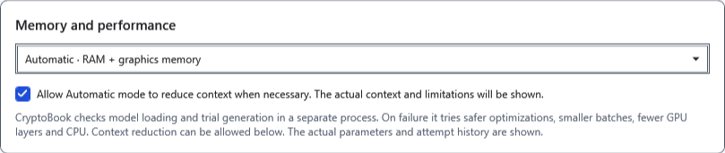
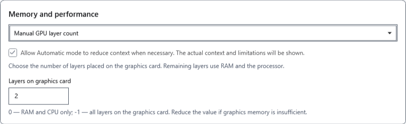
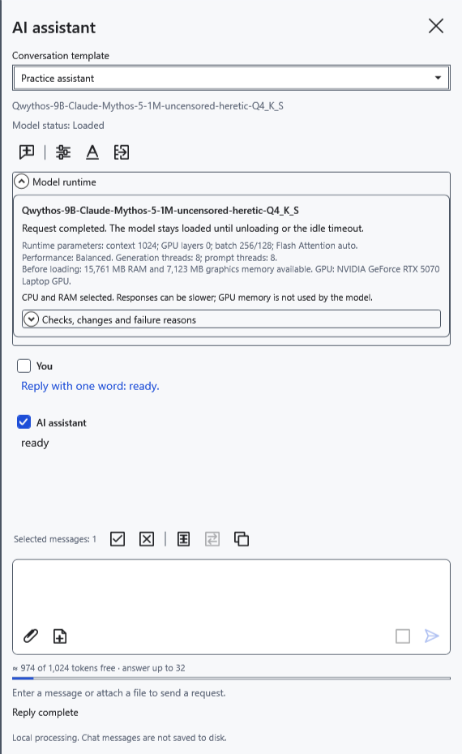
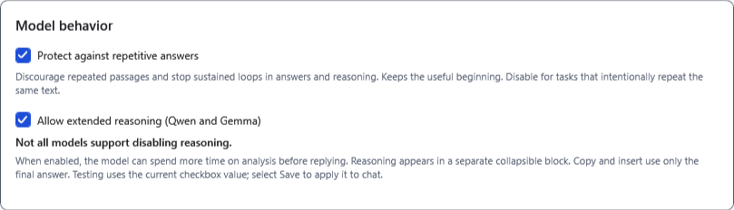
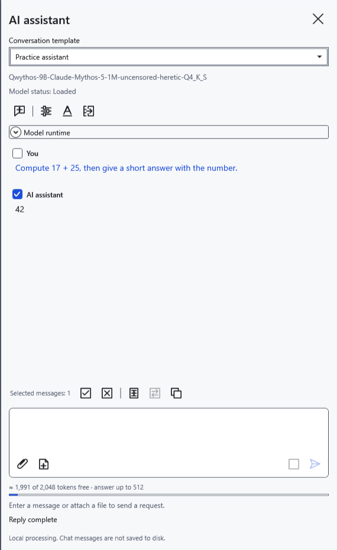

# Memory, GPU and reply behavior

Settings are saved separately for the selected GGUF file. Copy needed replies first: changing context, memory mode or reply behavior can clear the current chat and require loading again.

## Choose model placement

1. Open **Model settings → Advanced settings → Memory and performance**.
2. Start with **Automatic · RAM + graphics memory**. The application chooses placement using available memory; after a failed load it may reduce GPU layers or fall back to CPU. This cannot guarantee that every model will fit.
3. If acceptable, allow automatic mode to reduce context. The effective window may then be smaller than requested. Without permission a large context should not silently shrink. Check the effective size and warnings in **Model runtime**.

4. For manual placement, select **Manual GPU layer count** and use **Layers on graphics card**. Zero keeps layers on CPU; −1 requests all layers on GPU; a positive number requests that many layers. “All” does not mean memory is sufficient. Support depends on the model, driver and hardware.

5. To avoid GPU layer offload, select **CPU only · RAM**. Click **Save**, send a short question and expand **Model runtime**. Compare actual GPU layers, context and threads with your expectations. CPU may be slower and still needs RAM.

If memory is insufficient, reduce context, choose a smaller GGUF or unload an unused model. Do not increase GPU layers solely in pursuit of speed. The application does not close other programs. Automatic context reduction does not apply to performance measurement: that tests the selected context size.

## Reasoning and repetition protection

Find the behavior options in the same section:

- **Allow extended reasoning (Qwen and Gemma)** lets a supported model emit analysis. The option cannot add this capability to other models or guarantee that a particular GGUF follows it. Reasoning consumes time and shared context. Turning it off does not guarantee the absence of explanations in ordinary reply text.
- **Protect against repetitive answers** combines repetition controls during token sampling with stopping persistent exact loops. Useful text already received remains. Paraphrased repetition may go undetected. Temporarily turn protection off for deliberately repeated lines, then enable it again.

If the model supplies separate analysis, expand it in the message. Copying and applying use the answer without separately marked reasoning. Not every GGUF supplies this channel; the absence of an expandable analysis block is not by itself an error.

Before saving, click **Cancel**. After saving, restore previous values and save again; this does not recover cleared messages. If manual placement fails to load, return to automatic or CPU mode and test a short question.

- [Context and reply limit](help:ai.context)
- [Performance and measurement](help:ai.performance)
- [Choose and test a model](help:ai.models)
- [Assistant problems](help:ai.troubleshoot)
