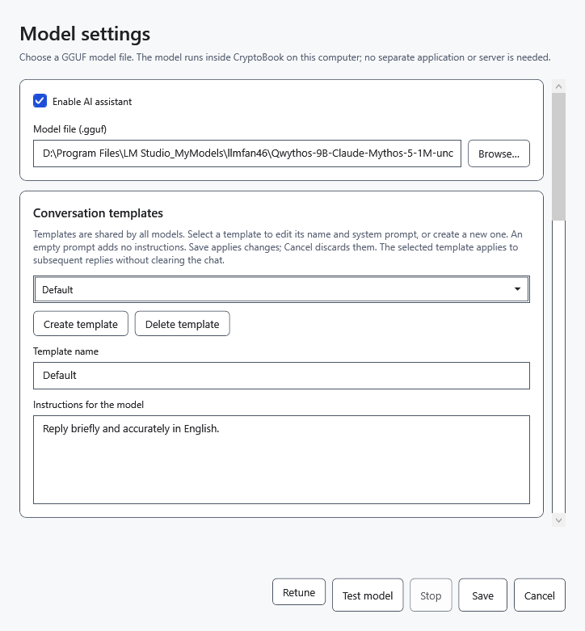
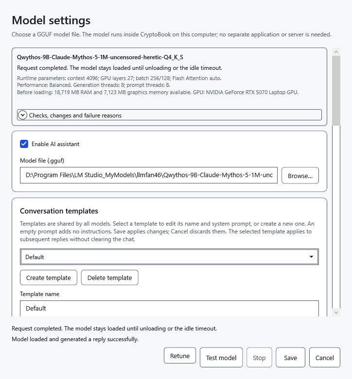
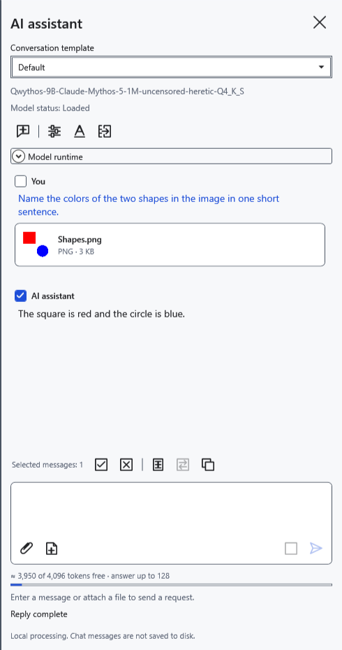

# Choose and test a model

A language model is a local `.gguf` file. Choose the model itself, rather than an auxiliary `mmproj`. The architecture and available memory must be checked by running it; the GGUF extension alone does not guarantee compatibility.

## Configure the model

Before switching models, transfer any replies you need to a document: switching clears the chat, draft and attachments and unloads the previous weights.

1. Open **Settings → AI assistant → Model settings**, or the gear in the panel.
2. Select **Enable AI assistant**. Click **Browse…** beside **Model file (.gguf)** and choose an existing language GGUF. You can also enter its full path or choose a previously configured model from the list, which appears when several models are available.
3. Optionally click **Test model**. The test uses the current values in the window, actually loads the model and requests a short reply. **Stop** cancels the test. A successful text test does not establish image support.
4. Click **Save** to apply settings and close the window. **Cancel** or closing discards unsaved edits; a completed test may have left the model loaded.

## For images

You need a vision-capable model and its compatible projector. Place exactly one GGUF with `mmproj` in its name beside the language GGUF. CryptoBook discovers it automatically; there is no separate projector picker. Image requests fail if none or several are present. A filename cannot establish compatibility: an unsuitable projector may cause a processing error.

After saving, attach a safe test image and ask about visible details. Only an actual image reply checks this capability. The image encoder uses the CPU and RAM; processing can take longer than a text reply.

## Saving and errors

Parameters are remembered for each model file; conversation templates are shared across models. **Retune** repeats automatic memory configuration; it does not download a newer GGUF or select the fastest performance mode. After testing or changing settings, use **Unload model** in the panel if necessary. If a file has moved, select its new path. A save error leaves the window open: fix the cause or click **Cancel**.

- [Enable the assistant](help:ai.start)
- [Model lifecycle](help:ai.lifecycle)
- [Troubleshooting](help:ai.troubleshoot)
- [Attachments](help:ai.attachments)
- [Model memory](help:ai.memory)
