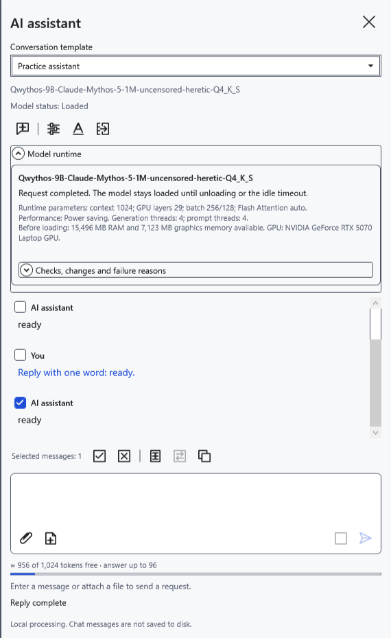
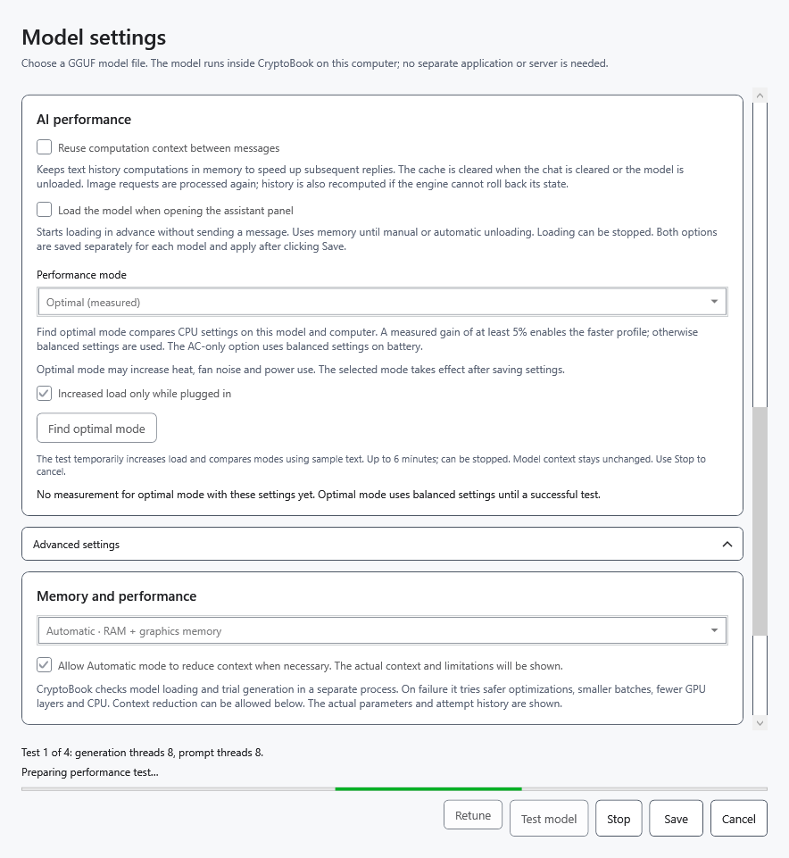
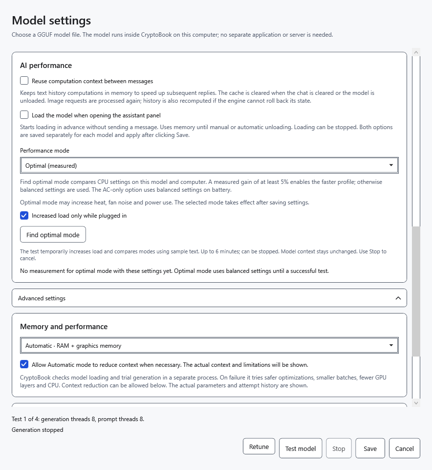
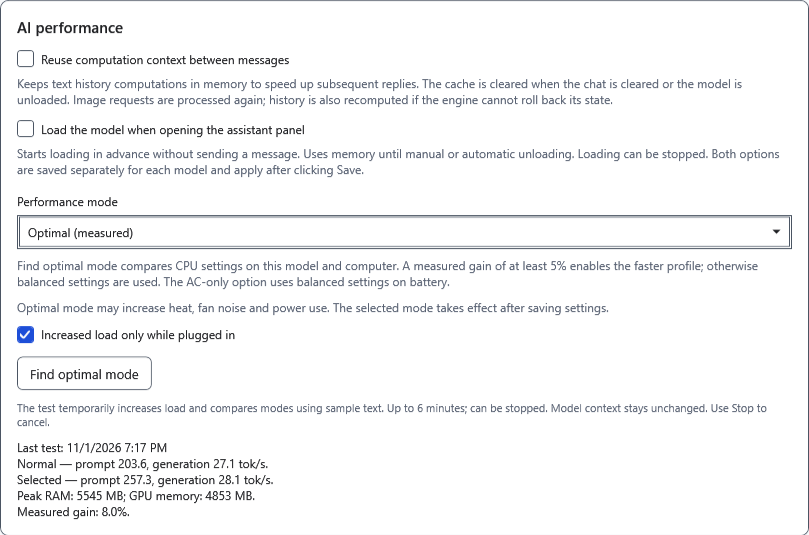

# AI performance and measurement

The mode is an optional choice saved separately for each model file. Speed depends on hardware, model, context and current load. Higher load does not guarantee a faster answer.

## Choose a mode

1. Open **Model settings → AI performance → Performance mode**.
2. Choose **Balanced** for ordinary use. **Power saving** reduces thread counts and uses Windows energy-saving scheduling. It is not a fixed GPU power limit or a promise of specific battery life.
3. Click **Save** and send a short question. **Model runtime** shows the active profile. A mode change retains the conversation and draft, but unloads the model; the next request loads the model again.

## Find an optimal mode

Finish the current reply first. Testing can increase load, heat and fan noise; do not run several measurements at once.

4. Select **Optimal (measured)** in settings. **Increased load only while plugged in** is enabled by default. On battery this restriction blocks increased load; disable it only as a deliberate choice.
5. Click **Find optimal mode**. The chat's mode does not change until **Save**. Measurement warms up the model and compares a normal profile with available higher-load candidates; it can take up to six minutes. It tests the selected context without automatic reduction.

6. Click **Stop** if necessary. The model used for testing is unloaded; **Find optimal mode** can be used again. Cancellation does not count as a successful measurement.

7. Read the result: input-processing and generation speeds, and the comparison between normal and selected profiles. Increased load is chosen only for a measured gain of at least 5%; otherwise normal load remains selected. These numbers describe this test, not guaranteed speed in a long chat or with images.

8. Click **Save** to apply the chosen mode to chat. Power conditions and available memory are also checked during subsequent use; restrictions may prevent increased load.

## Repeat or revert

**Retune** removes this model's stored automatic profile and performance result, then tests the model again. It does not download newer weights. Repeat measurement after changes to the model or conditions. **Find optimal mode** also performs a fresh measurement each time.

**Cancel** discards unsaved window settings; a completed measurement may already have updated the cached result. To return to ordinary use, select **Balanced** and save. Measurement itself does not delete the conversation. Insufficient resources can stop testing or restrict candidates; other programs are not closed. Reduce context, choose a smaller model or retry later. CPU/GPU placement can change the outcome.

- [Memory placement](help:ai.memory)
- [Context](help:ai.context)
- [Loading and stopping](help:ai.lifecycle)
- [Assistant problems](help:ai.troubleshoot)
