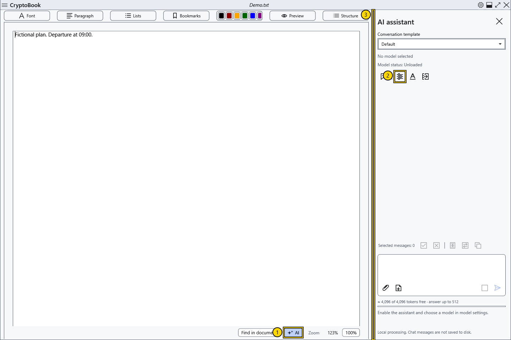

# Enable the local AI assistant

The assistant replies in a panel on the right and processes requests with a local model on your computer. No separate server is required. CryptoBook does not include model files or vision projectors; obtain them separately.

## Open and enable

1. Open an ordinary document and click **AI** at the bottom of the editor (1). In other window states, use **Settings → AI assistant** and its command to open the panel.
2. Click the **Model settings** gear in the panel (2). You can also use **Settings → AI assistant → Model settings**.
3. Select **Enable AI assistant**, choose a language GGUF and click **Save**. See the model article for details.

4. Enter a fictional test question and click **Send**, or press Ctrl+Enter in the prompt field. Wait for the reply and check it before using it.

## Result and return

The panel shows the selected model name, **Model status** and the reason sending is unavailable. Enabling the assistant does not mean that weights have loaded: normally loading starts with the first request. If **Send** is unavailable, read the explanation below the prompt.

Drag the panel's left edge (3) to change its width. The width survives closing and reopening the panel and is limited by the available window space. Clicking **AI** again hides the panel. Hiding preserves the chat and normally keeps weights loaded; click **Unload model** to release memory. Hiding the panel cancels unfinished preloading.

To disable the assistant, clear **Enable AI assistant** in settings. This stops the model and clears the current conversation. The chat, draft and attachments remain in memory only: they are not archived across application restarts and are removed when clearing the chat or resetting the key. Model settings and conversation templates are saved separately from messages. Local processing does not establish that an answer is accurate or give a model capabilities it lacks.

- [Choose and test a model](help:ai.models)
- [Loading, stopping and unloading](help:ai.lifecycle)
- [If the assistant does not reply](help:ai.troubleshoot)
- [Chat and messages](help:ai.chat)
