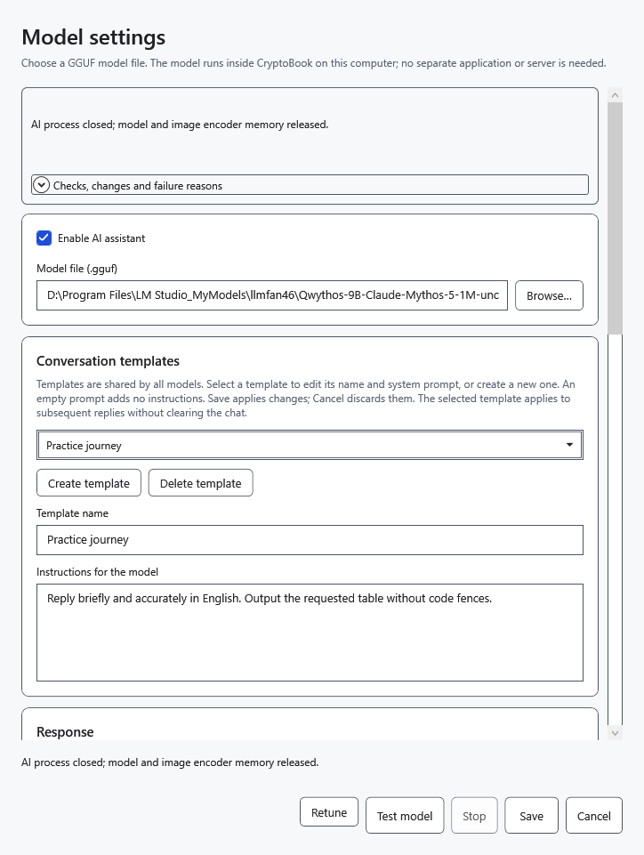
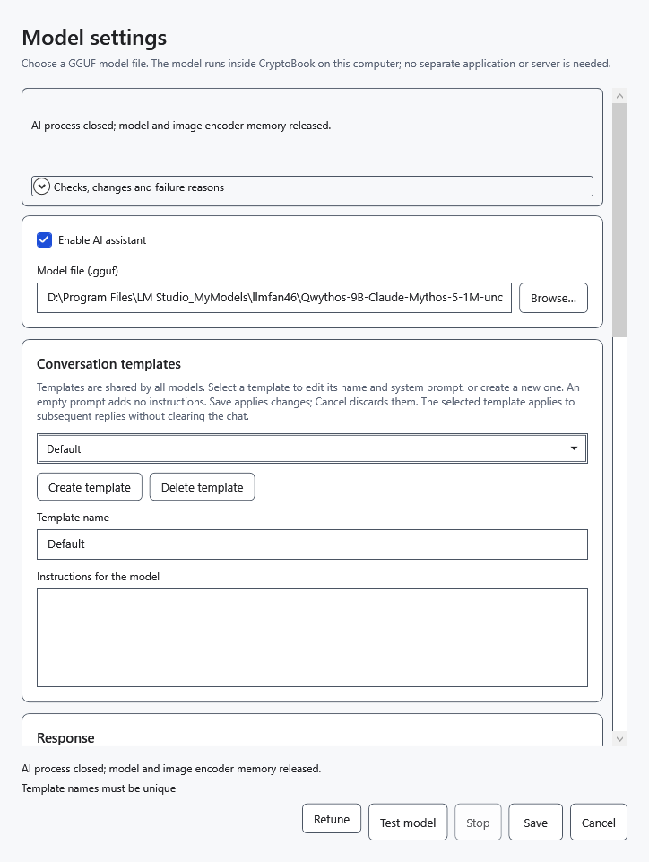
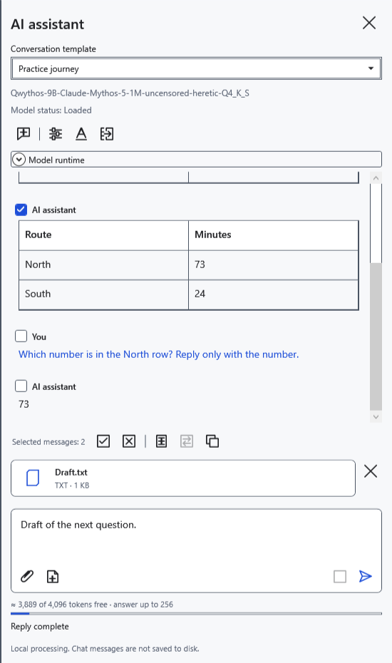
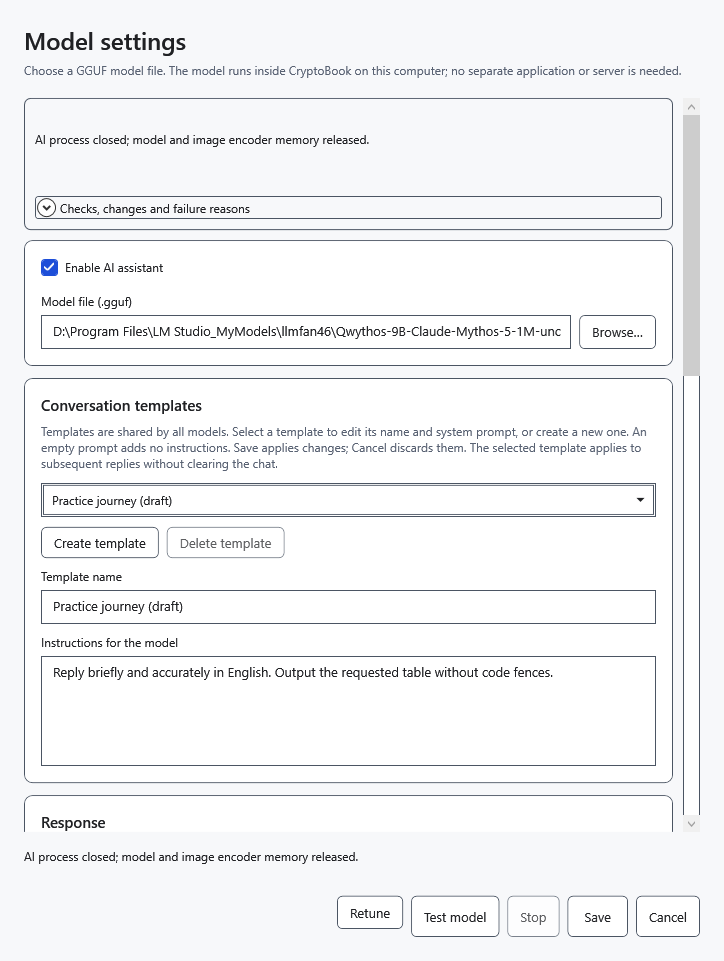

# Set up shared conversation templates

A template supplies shared instructions for subsequent requests with any selected model. It is not a separate chat or memory profile. Six presets are bundled: **Default**, **Concise answers**, **Step-by-step explanations**, **Text editor**, **Analyst**, **Programming assistant**.

## Create or edit

1. Open **Model settings** from the AI panel and scroll to **Conversation templates**.
2. Click **Create template** or select an existing item.
3. Enter a nonempty, unique **Template name**.
4. Fill in **Instructions for the model**. An empty instruction is allowed and adds no custom directions. Click **Save** to apply.

A missing name produces a prompt to enter it. Duplicate names, including differences in letter case alone, cannot be saved. Correct the name and click **Save** again.

## Select for the next request

Choose a **Conversation template** at the top of the panel. The selection is saved and applies across models. Existing replies are not rewritten; history, draft, attachments and loaded weights remain. The panel selector is unavailable during a reply. Template edits made in settings apply to the next request.

Instructions request a behavior but cannot guarantee that a model follows it. Preset names follow the UI language; custom names and instruction text are not translated automatically. Updates preserve saved edits, additions and deletions instead of replacing them with the original set. Older per-model instructions may appear as additional shared templates.

## Delete or cancel

Select an item, click **Delete template**, then **Save**. This removes it from the shared set. The last remaining template cannot be deleted.

**Cancel** or closing discards unsaved creation, edits, deletion and selection. After saving, there is no general undo for deletion. Changing templates alone preserves the chat; changing the model or other model parameters in the same window may clear it, so transfer needed replies to a document first.

- [Chat and message selection](help:ai.chat)
- [Model selection](help:ai.models)
- [Transfer a reply](help:ai.apply)
