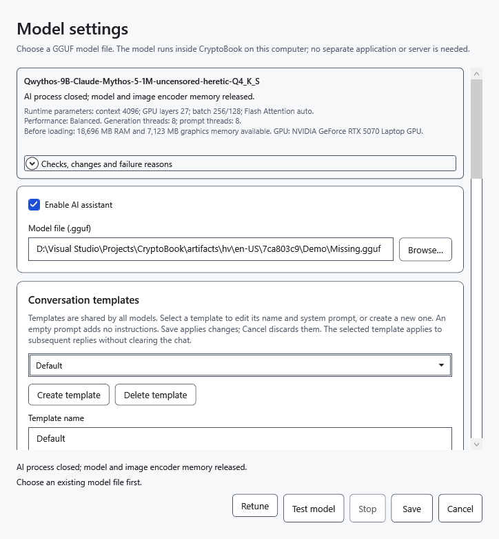

# If the AI assistant does not reply

Start with the explanation below the prompt, the error text and **Model status**. These describe different things: weights may remain in memory after a completed or stopped reply.

## Sending is unavailable

- Assistant disabled: open **Model settings**, select **Enable AI assistant**, choose a GGUF and save.
- Empty question without attachments: enter a question. If attachments are being read, wait for completion.
- Previous request still running: wait for the reply or click **Stop**.
- Workspace actually locked: unlock it with the previous key first. A saved snapshot alone does not prevent ordinary requests.

## Model or image error

**Choose an existing model file first.** means the path is empty or unavailable. Reconnect the drive or choose an existing file. Selecting `mmproj` as a language model or using a file with an invalid header causes format rejection. Renaming a different file to `.gguf` does not make it a model. Invalid settings do not replace the previously saved configuration.

Text works but images fail: check vision support, projector compatibility and exactly one GGUF with `mmproj` in its name beside the model. Do not select it instead of the language model. An encoder error can indicate incompatibility, a damaged image or insufficient memory; try a small valid image. A text model test does not test vision.

## Memory pressure, long chat or process failure

1. If an operation is active, click **Stop** and wait. Use **Unload model** to release weights.
2. Expand **Model runtime → Checks, changes and failure reasons**. It shows actual attempts and parameters, which may differ from your request after automatic configuration.
3. For insufficient memory, choose a smaller model or context. Advanced settings can select automatic memory placement or RAM-only operation. This may reduce speed. **Retune** in automatic mode repeats configuration; it cannot guarantee every model will work.
4. If the conversation exceeds the context, transfer any needed reply to a document before starting **New chat**, or reduce attachments. Clearing irreversibly removes the conversation from memory. Increasing context requires more memory.

No visible reply does not necessarily mean unloading: increase the reply limit and check reasoning settings. Repetition protection may stop sustained verbatim loops; it does not detect every semantic repetition.

If the isolated process fails, the document stays open. Preserve any partial text and retry manually after fixing the cause. Before output begins, automatic configuration may retry with safer parameters; after partial output, there is no automatic repetition. An unexpected idle exit changes status to **Unloaded**; a new request loads the model again. Stop, explicit unload and process failure are different outcomes.

- [Choose and test a model](help:ai.models)
- [Stop and unload](help:ai.lifecycle)
- [Memory](help:ai.memory)
- [Attachments](help:ai.attachments)
- [Recovery after resetting the key](help:recovery.lock)
