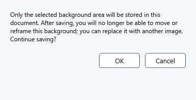

# Page background and cropping

A background fills the paper behind text. Unlike an embedded image, it can move within the page frame. Keep the original image separately before final saving.

## Steps

1. In **Font**, under **Paper**, click **Choose document background image. Move it on the page with Ctrl + left mouse button.** and choose a file.
2. Hold Ctrl and drag the background with the left mouse button. Esc cancels the current drag. **Remove document background image** removes the background.
3. Save as XamlPackage. The first save of an adjustable background asks you to finalize the crop. Read the warning; cancelling leaves the file and adjustable background unfinalized.

## Check, undo and limitations

After a successful write, only the visible area is retained: hidden edges are discarded and moving that saved crop is locked. Choose the original image again for another crop. A failed or cancelled write is not a successful save. Ctrl+Z can reverse edits but cannot recover discarded pixels from an already written file. RTF/TXT/XAML are unsuitable for retaining this background; reopen XamlPackage to verify it.

## Related topics

- [Page settings and paper colour](help:edit.page)
- [Save and Save as](help:doc.save)
