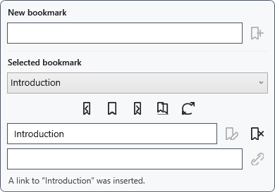
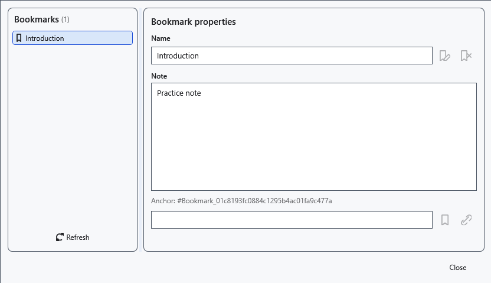

# Bookmarks, notes and internal links

A bookmark marks a position in an ordinary document. The current XamlPackage save does not restore bookmark anchors and notes after reopening. Link text may remain while its bookmark destination stops working. Do not rely on bookmarks as the only navigation in a saved file.

## Steps

1. Position the caret and expand **Bookmarks** above the document. Enter a name and click **Add at caret position**.
2. Select a bookmark. **Go to selected bookmark**, **Previous bookmark** and **Next bookmark** move the caret; adjacent navigation wraps around the document.
3. Enter a new name and click **Rename selected bookmark** to rename it. To insert a link, move the caret elsewhere, enter link text and click **Insert link to selected bookmark**.
4. Open **Open bookmark manager**, select an entry and edit its note. **Refresh index from document** rereads anchors in the current document.

## Check, undo and limitations

Check the name and destination. **Delete selected bookmark** removes the anchor, not the document file. Correct an empty or duplicate name according to the panel message. Closing the manager does not cancel changes already made; save the document explicitly. Refresh the index if moving or deleting text removes a bookmark. TXT, XAML and RTF do not guarantee preservation of anchors and notes.

## Related topics

- [Web links and display text](help:edit.links)
- [The document structure tree](help:content.structure)
