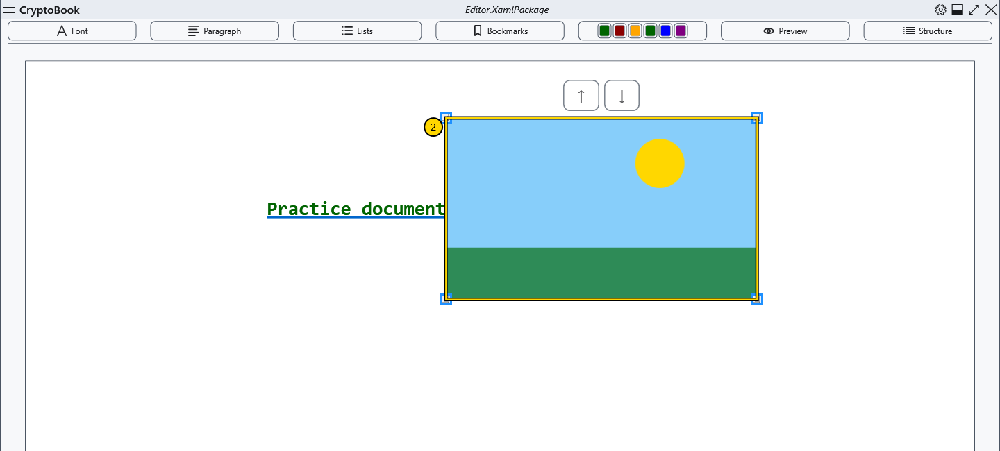
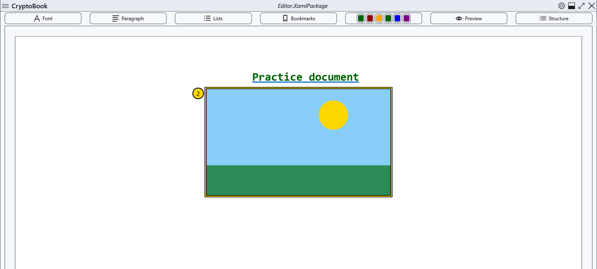
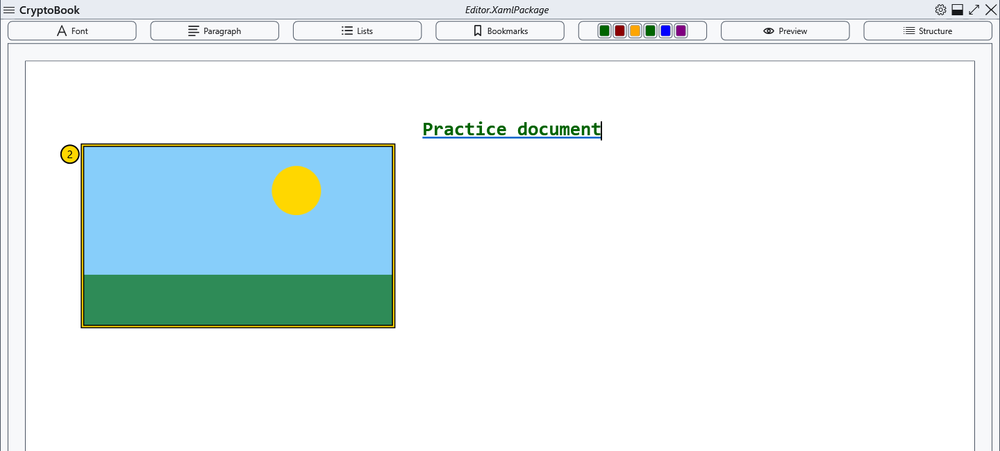
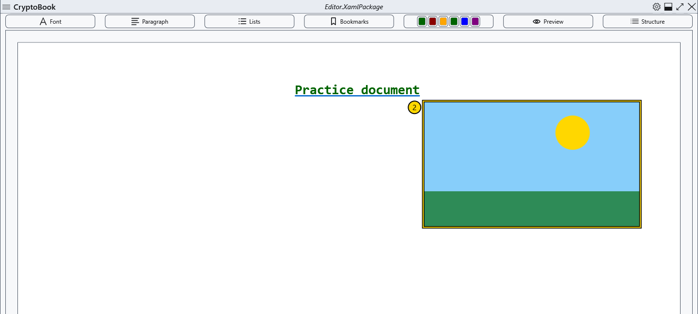

# Embedded images

Insert images into an ordinary document. Start with a disposable copy in editing mode; use XamlPackage to retain the complete layout.

## Steps

1. Position the caret and open **Content** → the image insertion command, or its context-menu equivalent. Choose a file; cancelling selection preserves the document.
2. Click the inserted image to show resize handles. Drag a handle while checking proportions and page boundaries.
3. In the image context menu choose inline, a centred block, float left or float right. The four illustrations below show those results in that order.

## Check, undo and limitations

Drag to reposition; the up/down commands and Alt+Up/Down move the selected image where an adjacent position is allowed. Delete removes the embedded item; Esc deselects it. Its original image file stays on disk. Undo does not guarantee recovery of the image itself. Save a copy first; if Ctrl+Z does not restore the image, insert the original file again. Reopen a saved copy and check dimensions and placement. In Markdown, use a relative link to a local image instead of this insertion command.

## Related topics

- [Page background and cropping](help:content.background)
- [Formats and encodings](help:doc.formats)
