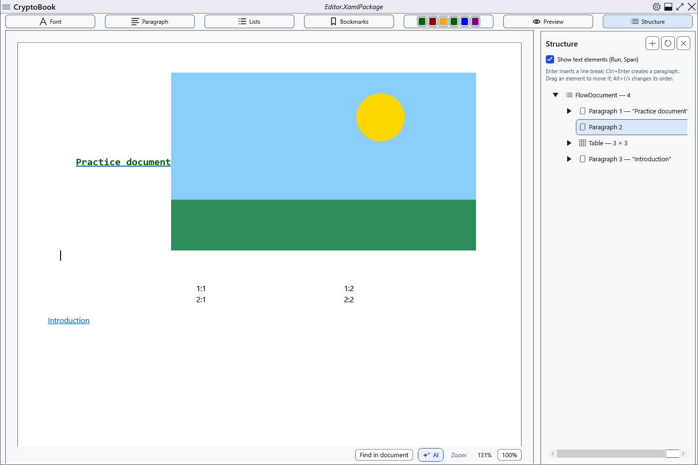

# The document structure tree

The structure panel helps find and rearrange parts of an ordinary document. Make a copy before deleting large passages.

## Steps

1. Click **Structure** above the document. Expand tree nodes and enable text elements for more detail. Refresh after changes if needed.
2. Select a node to navigate. Its context menu can add a paragraph before, inside or after a permitted element; the add button and Ctrl+Enter use the current selection.
3. Up/down commands, Alt+Up/Down and drag-and-drop reorder elements where the destination permits them. Deleting a node removes its contents from the document.

## Check, undo and limitations

Check the editor text and neighbouring nodes. Ctrl+Z reverses supported editor changes; closing the panel cancels nothing. Some elements cannot be deleted or nested arbitrarily: the root and protected anchors have restrictions. Preview disables navigation and editing through the tree; return to editing. After substantial rearrangement, save a XamlPackage copy and reopen it.

## Related topics

- [Basic text editing](help:edit.basic)
- [Editing an existing table](help:content.tables)
