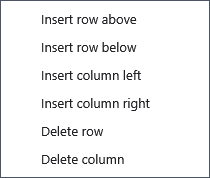

# Editing an existing table

Edit tables in ordinary documents, for example after inserting a formatted AI response or opening a XamlPackage containing a table. There is no separate command to create an empty table.

## Steps

1. Position the caret inside one cell and type to edit its text. Do not select several cells for a structure operation.
2. Open **Table** in the context menu to insert a row above/below or a column to the left/right.
3. Deleting a row or column removes its contents. Deleting the last row or column removes the whole table: save a copy first and use Ctrl+Z if needed.

## Check, undo and limitations

Structure commands require a rectangular table without merged cells, a caret or selection inside a single cell, and editing mode. They are unavailable outside a cell, across cells or with merged cells. Return to one suitable cell. Check row/column counts, undo and reopening in XamlPackage. Formulas and calculations are not provided. Edit a Markdown table in its source text.

## Related topics

- [Applying an AI response](help:ai.apply)
- [Formats and encodings](help:doc.formats)
