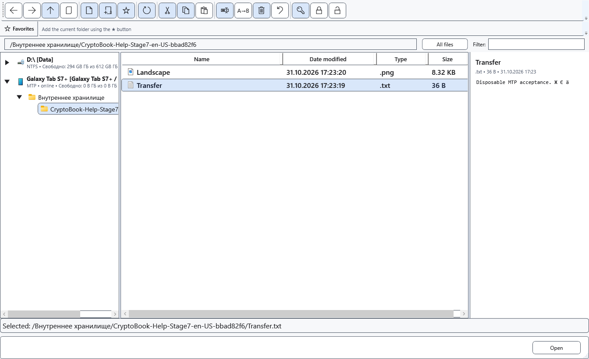

# Connect an Android device

Android can be used as an additional file source. Normal connections use Windows MTP file transfer; developer mode and ADB are not required.

## Before you start

Use a data-capable cable, unlock the device and allow shared-storage access. Folder visibility depends on Android and device permissions; protected app directories do not become accessible automatically.

## Steps

1. Connect the device, unlock it and choose its file-transfer USB mode. The exact Android labels vary by manufacturer.
2. Open the CryptoBook file manager. Select the device in the source tree, then its available shared storage and a folder.
3. Check the list and enabled commands using one disposable test file. Start by copying and keep the original.
4. When operations finish, end access to the device and disconnect it. After reconnecting, select the source and folder again.

## Check the result

The device source and its accessible folders appear in the tree. It is a file source, not a local search workspace. Some local-disk commands are unavailable on devices.

## Cancel and return

Use Cancel in the progress window and wait for the operation to stop before disconnecting. Removing the cable is not a cancellation method.

## If it did not work

No device source: check unlocking, USB mode, cable and Windows visibility, then reconnect. ADB is a separate optional route requiring debugging setup and computer authorization; offline/unauthorized states mean access is not ready.

## Related topics

- [Transfer files between a PC and Android](help:devices.transfers)
- [Device capabilities and limits](help:devices.limits)
