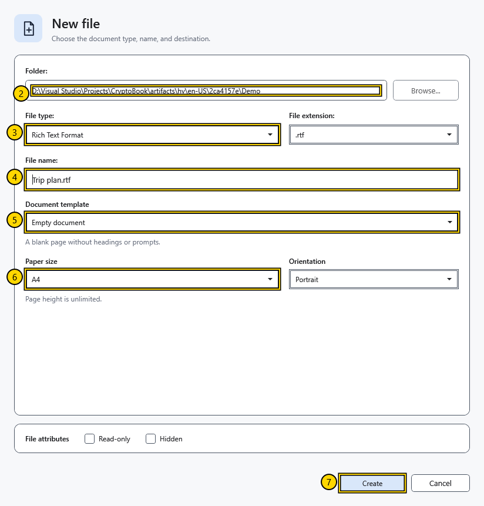
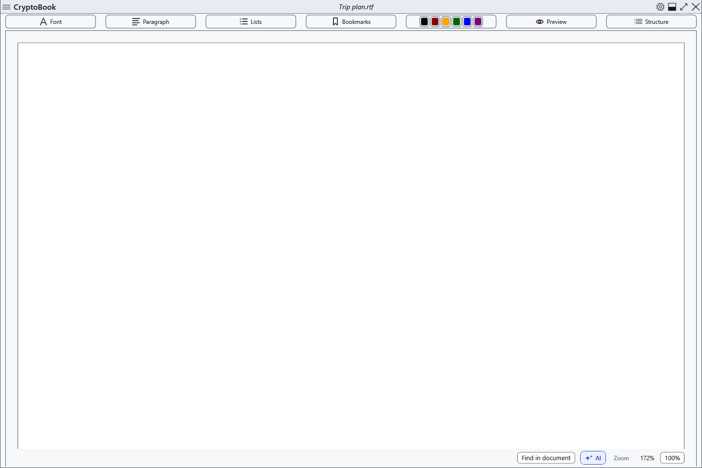
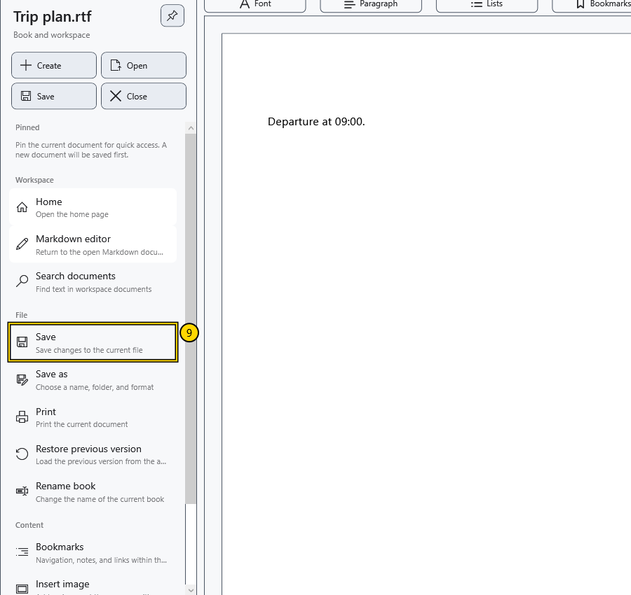
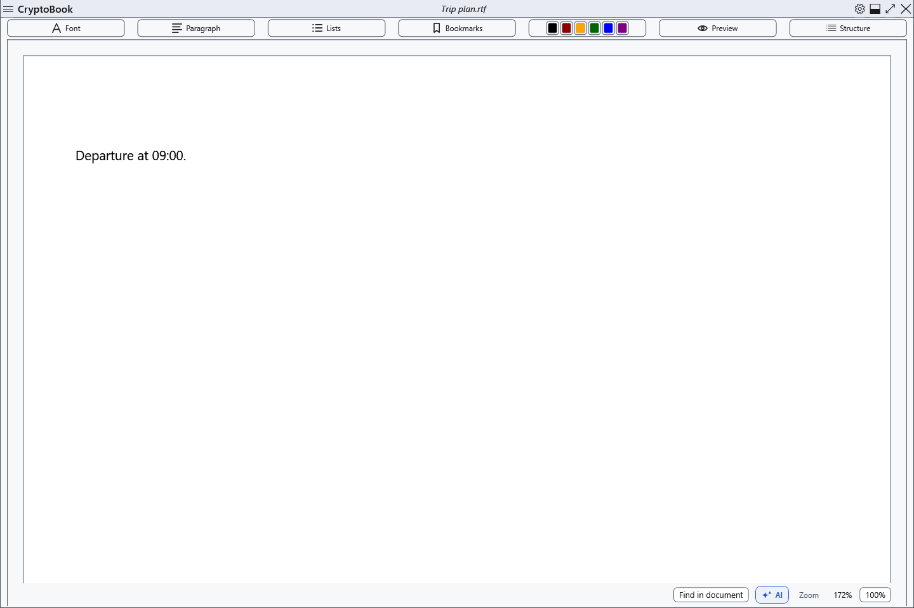
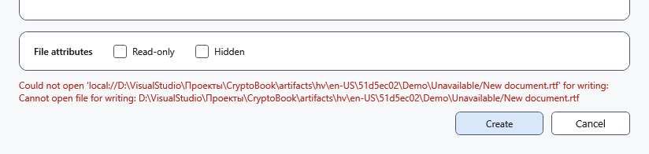

# Create and save a document

Create a blank RTF file, add a short line and save your changes. RTF is suitable for an ordinary document with text formatting.

## Before you start

Use a local folder where you can create files and a file name that is not already in use. This example creates **Trip plan.rtf**. Save any changes to an existing document before starting. An RTF file is not password protected.

## Steps

1. On the start screen, select **New document**. If a document is already open, use **Create** in the side menu instead.
2. In **Folder:**, use **Browse...** to select your demonstration folder.
3. In **File type:**, select **Rich Text Format** and check that **File extension:** is **.rtf**.
4. In **File name:**, enter **Trip plan.rtf**. Enter the name after selecting the type, because changing the type replaces the suggested name.
5. In **Document template**, select **Empty document**.
6. Set **Paper size** to **A4** and **Orientation** to **Portrait**. Leave **Read-only** and **Hidden** unchecked for this example.

7. Select **Create**. Wait for the new file to open in the ordinary editor; check its name in the top bar.

8. Click the page and type **Departure at 09:00.**
9. Open the side menu and select **Save** in the **File** section. Alternatively, press **Ctrl+S** while the editor has focus.

## Check the result

Open the same RTF file again with **Open** in the side menu. The line **Departure at 09:00.** should still be there. Check the actual document name if the application chose a different free name because of a conflict.

## Cancel or go back

Before selecting **Create**, use **Cancel** to leave the dialog. After creation, closing the document does not delete the file. To keep another name or location, use **File → Save as**; changing the file type may affect what formatting is retained.

## If something goes wrong

If **Create** is unavailable, check that a folder, file type and name are selected and that the folder is writable. If an error appears, read it and correct the name or choose another folder. If you see **The file was created, but could not be opened.**, check the folder before trying again: the file may already exist. **Save** may be unavailable when there are no new changes or the ordinary document is in reading mode.

## Other types, templates and attributes

This example uses an empty RTF. Choose another **Document template** for prepared text. For Markdown, choose its file type: a separate editor opens and paper settings are hidden. Text types, including XAML, do not retain formatting.

**Read-only** and **Hidden** set attributes on the new local file. They do not encrypt or password-protect it. Leave them unchecked for ordinary work. Other storage sources may have different capabilities.

If a name is taken, the application chooses a free name, which can differ from what you entered. Enter only a file name and select the folder separately. After creation, always check the name at the top and the actual file in the folder.

If the selected folder becomes unavailable, the dialog may remain open with an error. Choose an accessible folder and retry. Check whether a file from the previous attempt already exists first. **Cancel** does not delete a file that was already written.

To verify saving, close the saved disposable file before reopening it: selecting an already active file may merely return to its editor.

## Related topics

- [Main areas of the window](help:start.interface)
- [Save and Save as](help:doc.save)
- [Choose a document template](help:doc.templates)
- [Formats and encodings](help:doc.formats)
