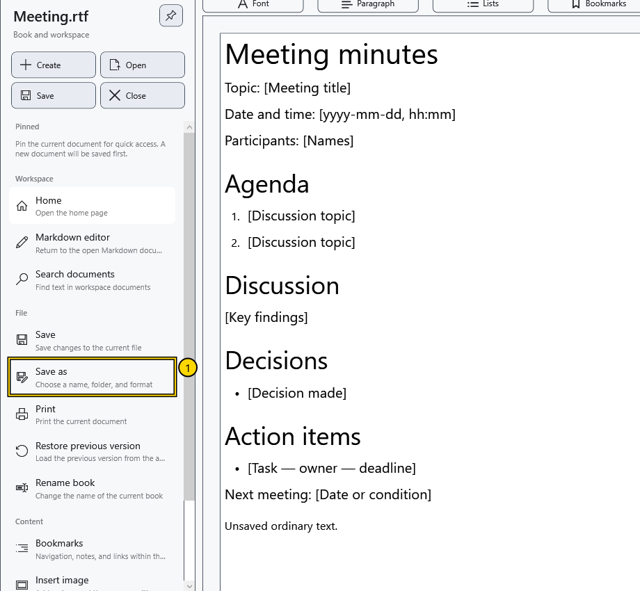

# Formats and encodings

The format determines what remains after saving and reopening. Choose TXT for text without formatting, or RTF or XamlPackage for a formatted document. Test on a copy before converting an important file.

## What is retained

| Format | Behaviour in CryptoBook |
| --- | --- |
| RTF (`.rtf`) | Formatted text and embedded images. Check complex layout compatibility with other editors separately |
| XamlPackage (`.XamlPackage`) | A formatted document with embedded resources, suitable for CryptoBook content including the page background |
| TXT and other ordinary text types | Text without fonts, colours, images or table structure |
| XAML (`.xaml`) | The current application opens and saves it as plain text; it does not substitute for XamlPackage |
| Markdown (`.md`, `.markdown`) | Markup source in a separate editor; the preview is built from that source |
| Protected document (`.cbook`) | A CryptoBook container requiring the appropriate key for reading and writing |

Text export may retain words from a table, but loses the table itself and images. Changing an extension in the file manager does not convert data. Do not rely on always receiving a formatting-loss warning.

## Choose a format

1. Open **File → Save as**.
2. Choose a type and matching extension. Markdown offers its source format and a text file; an ordinary document cannot be reverse-converted to Markdown.
3. Save under a new name. Close the copy, reopen it and compare text, formatting and images with the original.

## Encodings

There is no separate interface control for choosing an arbitrary encoding. Ordinary text export writes UTF-8 without BOM. RTF and XamlPackage have their own representations; they are not plain UTF-8 text.

New Markdown uses UTF-8 without BOM. Opened Markdown preserves recognized UTF-8, UTF-16 or UTF-32, their BOM and existing line endings. Without a BOM, UTF-8 is expected; legacy single-byte encodings are not automatically guessed. Bytes that do not match the recognized encoding can produce replacement characters and a switch to UTF-8 on the next save. Do not overwrite an original displaying unreadable text: cancel work on it and prepare a correctly converted copy in an external editor.

## Check the result and return

After reopening, check Cyrillic and Ukrainian letters, umlauts, line endings and essential formatting. Cancelling the dialog does not change the current format. After a successful **Save as**, open the old file to return to the original: subsequent saves already target the copy.

PDF and media are not ordinary document save formats in this dialog. Their viewing is covered separately. Protecting a file does not restore information already lost through text export.

## Related topics

- [Save and Save as](help:doc.save)
- [Document templates](help:doc.templates)
- [Save Markdown](help:md.save)
- [View PDF](help:view.pdf)
- [Protected file compatibility](help:security.compatibility)
