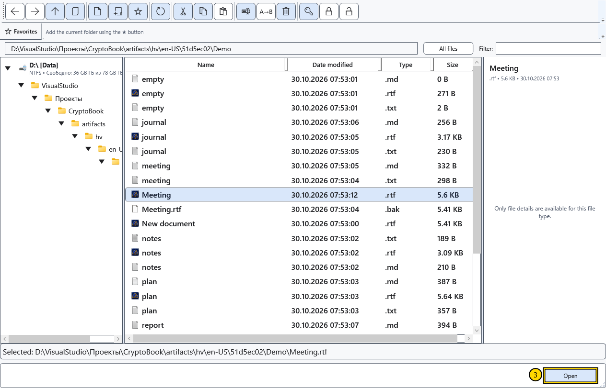

# Open a document

Open an existing file to read or edit it. Ordinary documents and Markdown use two independent editors. Opening another file of the same kind replaces the document in its corresponding editor.

## Before you start

Save changes you want to keep. If replacing a document asks about unsaved changes, cancelling leaves the current document open. A protected file needs the appropriate key. Other file types are routed to their corresponding viewers.

## Steps

1. Select **Open file** on the start screen or **Open** in the side menu's quick actions.
2. Navigate to the file's folder in the file manager. Its address bar belongs to that window and may differ from the workspace directory.

3. Select one file and choose **Open**, or double-click it. For a folder, the same action displays its contents.
4. If asked about unsaved changes, choose to save, continue without saving, or cancel. If saving fails, keep the original document open and resolve the cause or save a copy first.

## Where files open

| Content | Result |
| --- | --- |
| RTF, XamlPackage and ordinary text files | The ordinary editor on **Home** |
| Markdown | **Markdown editor**, with source text and preview |
| Supported images and video | The corresponding viewer or media player |
| PDF | The external application assigned in Windows |
| Protected CryptoBook file | Opens after format verification with the appropriate key |

An extension does not convert file contents. Do not rename an arbitrary file to `.rtf` or `.cbook` to convert it. Double-clicking in Windows File Explorer depends on installed file associations.

## Check the result and return

Check the name at the top of the window and a few lines of content. Return to the other editor through **Workspace → Home / Markdown editor**. Closing the file manager does not close a document already open in the main window.

In a folder or file picker, confirmation supplies the selection to the action that opened it; this differs from the normal file manager. **Cancel** stops selection. If a file will not open, check the drive connection, read access, actual format and whether a key is needed. An error message does not confirm successful opening.

## Related topics

- [Formats and encodings](help:doc.formats)
- [Two editors, renaming and closing](help:doc.switch)
- [Save and Save as](help:doc.save)
- [Protected file compatibility](help:security.compatibility)
