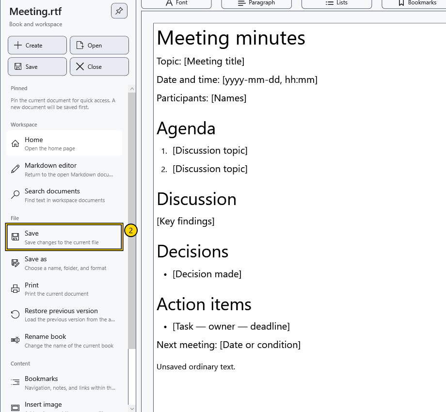
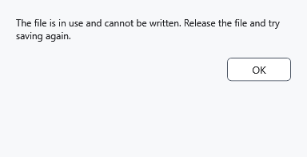

# Save and Save as

**Save** writes changes to the active document's current path. **Save as** chooses another name, folder or format and makes the new path current after a successful write.

## Before you start

Check the name at the top of the window and the active editor. The ordinary document and Markdown are saved independently.

> Keep a separate original before replacing an existing file or switching to a text format. Text export loses formatting; a separate warning is not shown in every case.

## Save the current file

1. Edit the document.
2. Open the side menu and select **Save** in the quick actions or **File → Save**. You can also use **Ctrl+S** in the editor.
3. Wait for writing to finish. A document without a path needs a destination first.

The command may be unavailable when there are no new changes. For an ordinary document in reading mode, return to editing first.

## Save to another location or format

1. Select **File → Save as**, or use **Ctrl+Shift+S** in the editor.

2. In the system dialog, choose the folder, name and file type. Check the extension: it also affects the selected format. Confirming overwrite replaces an existing file. System dialog labels depend on the Windows language.
3. Confirm the write and check the new name at the top. Subsequent **Save** operations use the new path; the old file does not receive later changes.

An ordinary formatted document cannot be exported directly to Markdown. For Markdown, save the source or a text copy; saving uses the source text rather than the displayed preview.

## Unsaved changes

Closing an edited document or replacing it with another file offers three choices. An affirmative answer saves and continues. A negative answer continues without writing the latest edits. Cancel keeps the document open and stops the action. The labels on these system buttons depend on Windows.

If saving is cancelled or fails, closing or replacement should not finish. Exiting the application checks both editors. Switching between the already open ordinary document and Markdown does not require discarding their changes.

## Check the result

Close the saved demonstration file and open it again. Check the latest lines and required formatting. A file with the right extension does not prove that the latest save finished.

## Cancellation and errors

**Cancel** in the destination dialog preserves the old path and unsaved text. Keep the editor open after a write error. Release the file in another program, check disk space and folder access, then retry **Save** or choose another destination with **Save as**.

Protected saving requires a key and separate confirmation. Having a key may also prompt an offer to create a protected copy of an ordinary file: read the chosen action and resulting path. Do not assume that every saved RTF or TXT is encrypted.

## Related topics

- [Formats and encodings](help:doc.formats)
- [Two editors, renaming and closing](help:doc.switch)
- [Write errors and recovery](help:recovery.write)
- [Protect documents](help:security.protect)
