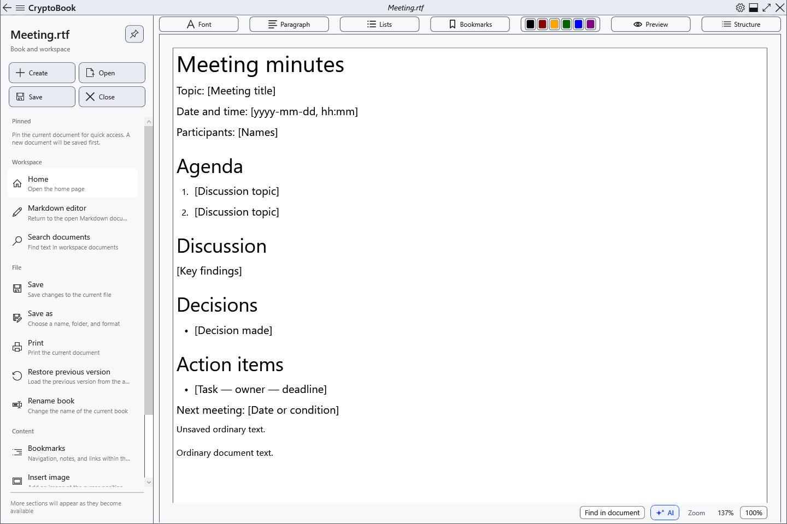
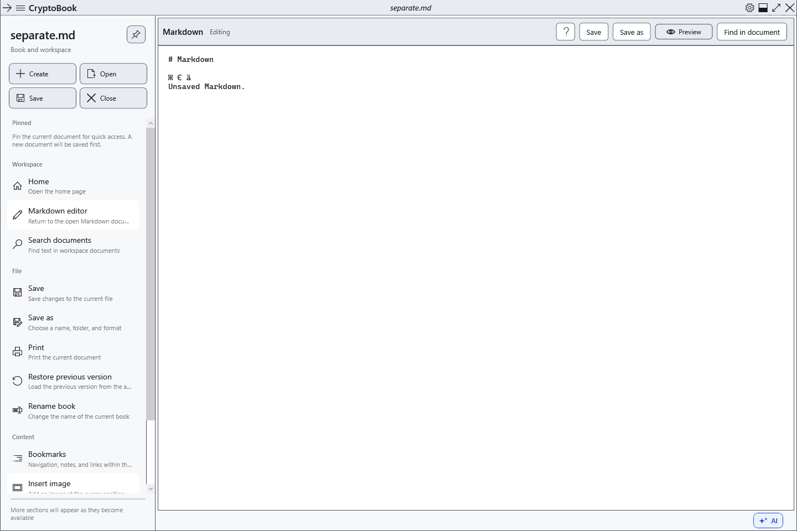
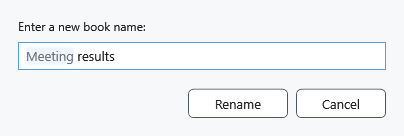

# Two editors, renaming and closing

CryptoBook keeps an ordinary document and Markdown independently. For example, leave RTF notes on **Home**, open a Markdown plan and return to the notes with their unsaved changes. These are two editors, rather than an unlimited set of tabs.

## Switch between documents

1. Open an ordinary document, then a Markdown file through **Open**.
2. Open **Workspace** in the side menu and select **Home** or **Markdown editor**. The Markdown command is available when a Markdown document is already open.

3. Check the name at the top before selecting **Save**. Saving one editor does not save the other.

The back and forward arrows at the top switch between already open application pages. They do not undo edits or restore an earlier file after another file of the same kind replaces it. Such replacement checks unsaved changes separately.

## Rename a book

1. Select the required editor and open **File → Rename book**.
2. Enter a new name and confirm with **Rename**. The extension is retained; this command cannot change the format.

For a file on disk, this changes its name in the same folder. For a document without a path, it changes the session name; a file is created only when saved. Renaming does not replace saving the latest edits. **Cancel** keeps the old name. If the name is taken or invalid, or the file is locked, resolve the cause and check the actual name after any error.

## Close a document or the application

The **Close** quick action applies to the active document. With unsaved edits, choose to save, continue without writing, or cancel. Cancel keeps the document open; declining to save loses its latest edits. Successfully closing one editor does not close the independent second document.

The main window's close button exits the application and checks changes in both editors. A save error or cancellation interrupts closing. Closing a document does not delete its file on disk. Reopen a saved file to return; this does not recover unsaved edits that were discarded.

## Check the result

Enter different lines in disposable RTF and Markdown files, switch both ways and check that the texts are separate. Save each independently and reopen them. If an unexpected file is displayed, check the active page and name before saving or renaming.

## Related topics

- [Open a document](help:doc.open)
- [Save and Save as](help:doc.save)
- [Pinned documents](help:files.pinned)
- [Recent documents](help:files.recent)
