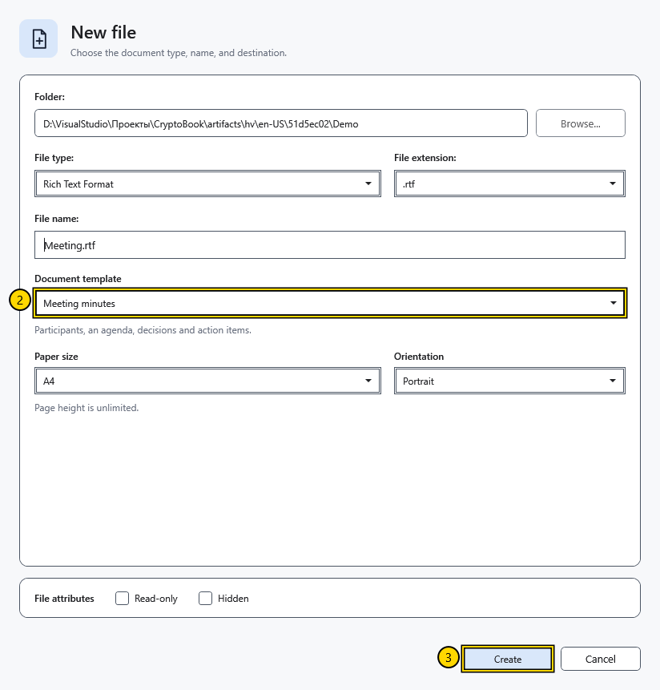

# Choose a document template

A template fills a new file with starting content. For example, **Meeting minutes** provides an outline for an agenda and decisions. The file type controls storage; the document template controls the initial text.

## Steps

1. Select **New document** on the start screen or **Create** in the side menu. Choose the folder, file type and name.
2. Select an outline under **Document template**. Read its description below the list.

3. Adjust the paper size and orientation if needed, then select **Create**. Paper settings are hidden for Markdown.

| Template | Use it to |
| --- | --- |
| Empty document | Start without prepared text |
| Notes | Collect short notes |
| Project plan | Organize work into stages |
| Meeting minutes | Record discussion, decisions and tasks |
| Journal | Write a personal entry |
| Report | Prepare a structured summary |

RTF and XamlPackage turn the template into a formatted document. A text file loses formatting. Markdown keeps the source text with markup. New content uses the application language at creation time; changing the language does not translate files already written.

## Default template

Open **Settings → Appearance → Default new document template**. The choice applies to the next creation dialog; it does not overwrite existing documents or a dialog already open. You can choose another template in each new dialog.

## Check the result and cancel

After creation, check the headings and text in the open file. Close it and open it again to check persistence. **Cancel** before creation leaves no new file. Cancelling a dialog after a file was created does not delete that file.

If you expected formatting, check the file type: **Text file** and **XAML file** store text only. Changing the default template does not replace the current document text.

## Related topics

- [Create and save a document](help:doc.create)
- [Formats and encodings](help:doc.formats)
- [Appearance settings](help:settings.appearance)
