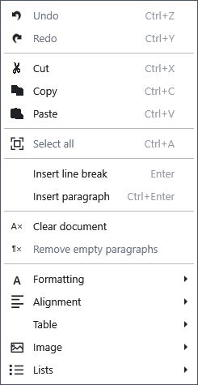

# Basic text editing

Select a passage to replace, copy or remove it. These commands work in the ordinary document editor; click its text first.

## Steps

1. Drag across text or use Shift with the arrow keys. Ctrl+A selects the whole document.
2. Open the context menu: **Copy** (Ctrl+C), **Cut** (Ctrl+X), **Paste** (Ctrl+V). Pasting replaces the selected passage.
3. Use **_Undo** (Ctrl+Z) and **_Redo** (Ctrl+Y) to correct changes. Enter inserts a line break within the current paragraph; Ctrl+Enter starts a new paragraph.

## Check, undo and limitations

**_Clear document** removes all content of the current document: save a copy first. **Remove _empty paragraphs** removes empty paragraphs and may close intentional gaps. Check the text and undo an unwanted change before continuing. Undo history does not replace a backup of the file. If a command is unavailable, check selection, keyboard focus and editing mode.

## Related topics

- [Fonts, text colour and highlighting](help:edit.font)
- [The document structure tree](help:content.structure)
