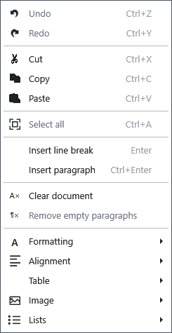

# Basic text editing

Select a passage to replace, copy or remove it. These commands work in the ordinary document editor; click its text first.

## Steps

1. Drag across text or use Shift with the arrow keys. Ctrl+A selects the whole document.
2. Open the context menu: **Copy** (Ctrl+C), **Cut** (Ctrl+X), **Paste** (Ctrl+V). Pasting replaces the selected passage.
3. Use **Undo** (Ctrl+Z) and **Redo** (Ctrl+Y) to correct changes. Enter inserts a line break within the current paragraph; Ctrl+Enter starts a new paragraph.

## Windows text suggestions

While you type, Windows can show suggested words above the cursor. You can choose a word without using the mouse:

1. When suggestions appear, press **↑** to move to them.
2. Use **←/→** to choose the word you want.
3. Press **Enter** to insert the selected suggestion.

**Esc** dismisses the suggestions without inserting a word. Enter accepts a word once you have moved to the suggestions; during ordinary typing it still inserts a line break.

This is a Windows feature. To enable it, open **Settings → Time & language → Typing** in Windows 11 or **Settings → Devices → Typing** in Windows 10. Turn on text suggestions for the physical keyboard. Availability depends on Windows settings and the input language.

## Check, undo and limitations

**Clear document** removes all content of the current document: save a copy first. **Remove empty paragraphs** removes empty paragraphs and may close intentional gaps. Check the text and undo an unwanted change before continuing. Undo history does not replace a backup of the file. If a command is unavailable, check selection, keyboard focus and editing mode.

## Related topics

- [Fonts, text colour and highlighting](help:edit.font)
- [Keyboard shortcuts and focus](help:settings.hotkeys)
- [The document structure tree](help:content.structure)
