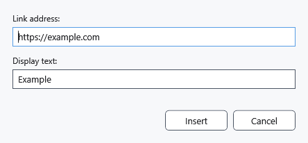

# Web links and display text

A hyperlink connects visible text to a web address. To jump within the document, use a bookmark link instead.

## Steps

1. Select the future label or position the caret. In **Paragraph**, click **Insert hyperlink**.
2. Enter an HTTP/HTTPS address in **Link address:**. If the scheme is missing, https:// is added. Enter a label in **Display text:**; a blank label uses the address.
3. Click **Insert**. Check the label and test the link in preview mode; external links open through the system application.

## Check, undo and limitations

**Cancel** closes the dialog without inserting anything. Ctrl+Z undoes insertion. An invalid address leaves the dialog open for correction. This dialog accepts web addresses; Markdown has separate link rules. Save formatted documents as RTF/XamlPackage and check links after reopening; bookmark persistence limitations are described separately.

## Related topics

- [Bookmarks, notes and internal links](help:content.bookmarks)
- [Markdown preview, links and images](help:md.preview)
