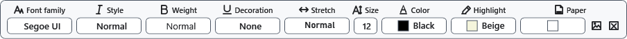

# Page settings and paper colour

Paper size determines the text width and preview pages. Paper colour belongs to the document and differs from the interface theme.

## Steps

1. When creating an ordinary document, choose paper size and orientation in the creation dialog before confirming. There is no separate command to change the size or orientation of an already open document.
2. In the open document, expand **Font**. Under **Paper**, select **Document background color** or a background image.
3. Switch to preview to check pages. Editing uses continuous page height; preview page breaks depend on paper size and content.

## Check, undo and limitations

Use Ctrl+Z to undo a colour change. For a different initial paper size, create another document with the required settings and transfer content while keeping the original. Use XamlPackage for paper colour, background and page settings. RTF does not retain every page setting; TXT/XAML lose formatting. Changing zoom does not change the paper dimensions.

## Related topics

- [Page background and cropping](help:content.background)
- [Preview, pages and zoom](help:edit.view)
- [Create and save a document](help:doc.create)
