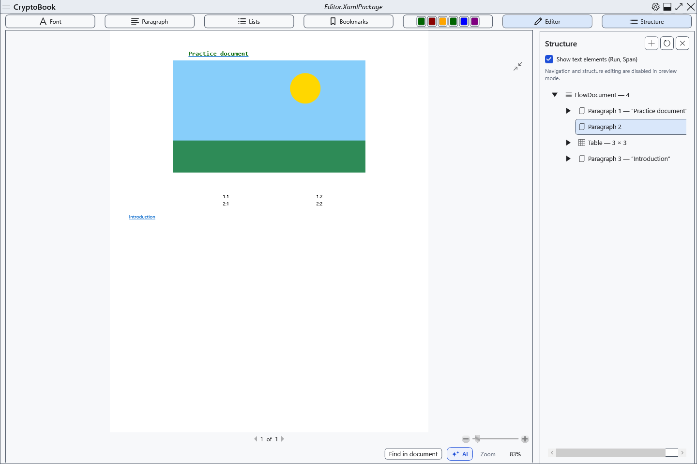

# Preview, pages and zoom

The ordinary document has editing and paginated preview modes. Preview helps inspect the layout while preserving the source document.

## Steps

1. Click **Preview** above the document. Return with **Editor**.
2. In the editor, Ctrl+mouse wheel adjusts zoom. The **100%** button at the bottom restores actual size; the indicator shows the current percentage.
3. In preview, use the fit-page button and standard zoom controls. With the viewer focused, Left/PageUp and Right/PageDown change pages; Home/End select the first/last page.

## Check, undo and limitations

Check the percentage and page number; switching modes preserves content. Preview disables navigation and edits through the structure tree: return to editing to make changes. Fit mode recalculates when the window changes size. Screen zoom does not alter paper size, saved font size or print settings. Markdown has a separate preview whose rendered result cannot be edited.

## Related topics

- [Page settings and paper colour](help:edit.page)
- [Printing a document](help:view.print)
