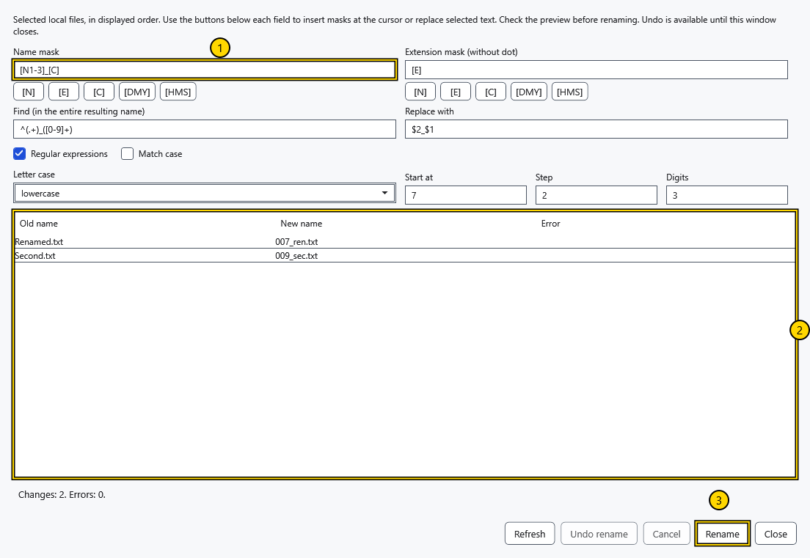
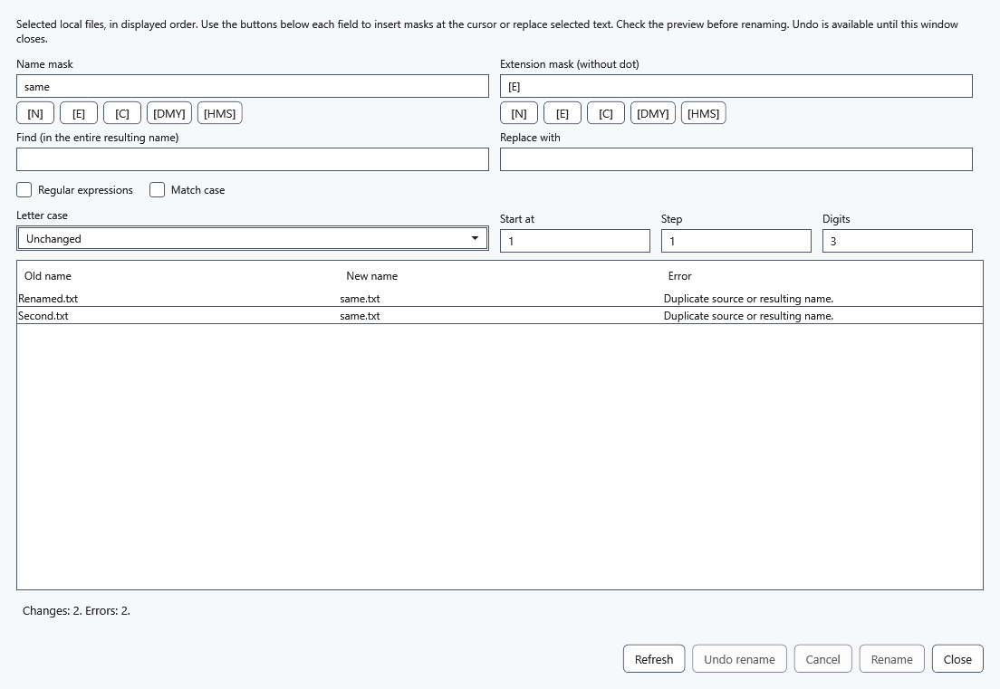
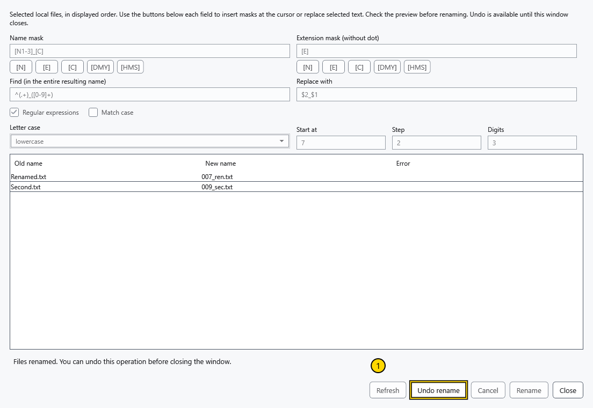

# Rename multiple files

The multi-rename tool changes at least two local files in one plan. Folders and Android/MTP objects are excluded. Keep a separate copy of important files; cancellation and recovery depend on access to their folders.

## Prepare the names

1. Select two or more local files in the manager. Sort the list first: the counter follows the displayed order, not selection order. Press Ctrl+M, click A→B or choose **Multi-rename tool** in the row menu. For one file use ordinary rename.
2. Set **Name mask** and **Extension mask (without dot)**. Token buttons insert at the caret or replace selected text in their corresponding field. Type literal text around tokens. The extension mask contains no leading dot; an empty extension mask removes the extension.

The numbered areas show 1 — name mask, 2 — preview, 3 — apply. Both masks accept:

| Token | Expansion |
| --- | --- |
| [N] / [E] | Original name without extension / extension without dot |
| [N1-5], [N3-], [E1-2] | Characters 1–5, name from character 3, extension characters 1–2; positions start at 1 |
| [C] | Counter using **Start at**, **Step** and **Digits** |
| [DMY] / [HMS] | Local date ddMMyyyy / time HHmmss, captured once for the entire preview |

For example, name mask Photo_[C], extension [E], start 1, step 1 and 3 digits produce Photo_001.jpg, Photo_002.jpg for JPG sources. Start must be nonnegative, step positive and digits 1–18. A range beyond the source length contributes an empty string.

3. If needed, set **Find (in the entire resulting name)** and **Replace with**. Replacement processes the entire constructed filename, including extension; **Letter case** is applied afterward. **Match case** controls matching. **Regular expressions** enables .NET regular expressions and replacement groups such as $1. A malformed expression blocks a valid preview.
4. Compare **Old name**, **New name** and **Error** for every row. Duplicate names, occupied targets, invalid or Windows-reserved names block application. **Refresh** rechecks the folder and updates the date/time used by tokens; execution uses the names already shown.

## Apply and undo

Choose **Rename** only after checking the preview. Name swaps and case-only changes are supported. Files first receive temporary names in their own folders and then final names; existing targets are not overwritten. After success, matching active, pinned and recent document paths follow the actual result. A reference-saving warning is separate from file-renaming success.

**Undo rename** restores names from the last successful operation while this window remains open. It checks conflicts again; a newly occupied original name can block undo. This is separate from editor Ctrl+Z. Close the window after checking the result.

## Cancel or recover from an error

Before applying, close the window without changes. During execution, **Cancel** or closing requests cancellation and waits for original names to be restored. External locks or occupied names leave data and a journal preserved; the status lists current paths. After removing the obstruction or restarting an interrupted process, open the first source file's folder in the file manager and choose **Restore operations**. The journal in the hidden .cryptobook-operation-* folder supports retry after restart and never overwrites existing objects. Keep folders containing unfinished recovery.

## Related topics

- [Sort, filter and select files](help:files.views)
- [Open, rename and delete](help:files.manage)
