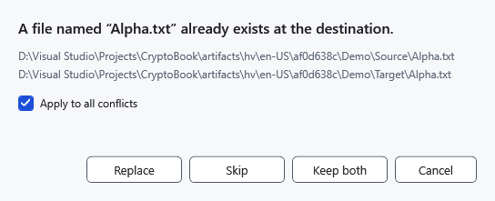

# Resolve name conflicts

A conflict appears when copying or moving would use an occupied destination name. Read the source and destination paths before choosing; identical names do not imply identical contents.

1. Check both paths in **Name conflict**.
2. Choose how to handle the object:

| Choice | Result |
| --- | --- |
| **Replace** | Stages the new local copy and retains the previous destination until the batch completes. Cancellation or failure restores the previous destination. A folder is replaced as a whole rather than merged. |
| **Skip** | Leaves the existing destination and does not transfer this source. |
| **Keep both** | Keeps the existing object and transfers the source under a free name. Verify the actual resulting name. |
| **Cancel** | Stops planning this batch. No transfers from this batch have started while these conflict decisions are being collected. |

**Apply to all conflicts** repeats the selected decision for remaining conflicts in this batch. Leave it clear if later objects need different decisions. Closing the conflict dialog is cancellation.

## After choosing

Wait for the operation to finish, refresh and compare the destination with the source. Skipping a move keeps that source in place. Copying an object into its own folder chooses a free copy name; moving it to its existing location is skipped.

Cancellation in the progress window rolls back completed actions in the local batch. The previous destination is retained until transfer completes. If a lock or occupied name prevents recovery, use **Restore operations** in the folder containing the journal identified by the message. After an interrupted process, open the destination folder and use that command.

## Related topics

- [Copy and move files](help:files.transfer)
- [Write errors](help:recovery.write)
